# VScode pour créer une appli mobile avec Cordova

> * Auteur : Gwénaël LAURENT
> * Date : 05/02/2021 - update le 07/05/2021
> * OS : Windows 10 (version 1903)
> * VScode : version 1.52.1 (system setup)
> * Node.js : version v12.16.2
> * JDK : version 1.8.0_192
> * Cordova : version 10.0.0
> * Gradle : version 6.7.1

 [Licence Creative Commons](https://creativecommons.org/licenses/by-nc-sa/3.0/fr/)


- [VScode pour créer une appli mobile avec Cordova](#vscode-pour-créer-une-appli-mobile-avec-cordova)
- [1. Installation des logiciels](#1-installation-des-logiciels)
  - [1.1 Installation du JDK](#11-installation-du-jdk)
  - [1.2 Installation de  Node.js](#12-installation-de--nodejs)
  - [1.3 Installation de Git](#13-installation-de-git)
  - [1.4 Installation de Cordova](#14-installation-de-cordova)
  - [1.5 Installation de Gradle](#15-installation-de-gradle)
  - [1.6 Installation du Android SDK Manager](#16-installation-du-android-sdk-manager)
- [2. Installation de l'extension VScode pour Cordova](#2-installation-de-lextension-vscode-pour-cordova)
- [3. Création d'un projet Cordova](#3-création-dun-projet-cordova)
  - [3.1 Création de l'architecture du projet](#31-création-de-larchitecture-du-projet)
  - [3.2 Création de la plateforme android](#32-création-de-la-plateforme-android)
- [4. Edition du projet dans VS Code](#4-edition-du-projet-dans-vs-code)
- [5. Déploiement de l'application sur un smartphone Android](#5-déploiement-de-lapplication-sur-un-smartphone-android)
  - [5.1 Création de l'application android (BUILD)](#51-création-de-lapplication-android-build)
  - [5.2 Configurer le smartphone pour le debug](#52-configurer-le-smartphone-pour-le-debug)
  - [5.3 Installation de l'appli et lancement sur un smartphone (RUN)](#53-installation-de-lappli-et-lancement-sur-un-smartphone-run)
- [6. Accès à une API Web distante depuis l'application cordova](#6-accès-à-une-api-web-distante-depuis-lapplication-cordova)
- [7. Plugins](#7-plugins)
- [8. Emulateur android](#8-emulateur-android)

# 1. Installation des logiciels

## 1.1 Installation du JDK
> JDK = Java Development Kit

Vérifiez si le JDK en version 1.8 ou supérieure est déjà installé sur votre machine.
Si ce n'est pas le cas, suivez le tuto "[Installation du JDK](../java/installer_jdk.md)"

Ne pas oublier de créer la variable d'environnement système ```JAVA_HOME``` qui doit pointer vers l'emplacement du JDK.


## 1.2 Installation de  Node.js
Vérifiez la version de nodeJS installé sur votre poste. Ouvrez un terminal :
```shell
> node -v
v12.16.2
```
Si la commande précente n'existe pas ou que la version de node est inférieure à v10.16.3, mettez à jour nodeJS en suivant la doc "[Installation de nodeJS](../nodejs/installer_nodejs.md)"


## 1.3 Installation de Git
Vérifiez si l'utilitaire Git est déjà installé dans un terminal :
```shell
>git --version
git version 2.29.2.windows.2
```

Si git n'est pas reconnu en tant que commande interne, installez le en suivant la doc "[Utilisation de Gitlab §5. Installation du logiciel git](../gitlab/readme.md#5-installation-du-logiciel-git).


## 1.4 Installation de Cordova
Vérifiez si cordova est déjà installé dans un terminal :
```shell
> cordova -v
10.0.0 
```

Si cordova est déjà installé mais avec une version antérieure, désinstallez le :
```js
> npm -g uninstall cordova
```

Installez cordova. Toujours dans un terminal :
```shell
> npm install -g cordova
```

Lancez cordova dans un terminal, désactivez l'envoi de statistiques :
```shell
> cordova
? May Cordova anonymously report usage statistics to improve the tool over time? No
```

## 1.5 Installation de Gradle

> Gradle est un logiciel gestionnaire de Build. Il permet de construire des programmes exécutables à partir des codes sources et des dépendances du projet (bibliothèques, etc).
 
Téléchargez la dernière version de gradle sur [https://gradle.org/releases/](https://gradle.org/releases/)

Téléchargez la version "```binary-only```"

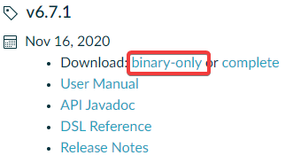

Créez un nouveau dossier ```C:\Gradle``` et copiez le contenu du fichier zip téléchargé (```gradle-6.7.1-bin.zip```) dans ce dossier. Cela devrait donner une arborescence comme celle ci :

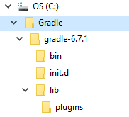

Modifiez les ```variables d'environnement Windows``` pour Gradle :

* Affichez la fenêtre de modification des variables d'environnement système :
  * Paramètres Windows > Système > Informations système > Informations système > Paramètres système avancés > Cliquez sur le bouton "Variables d'environnement" > zone "Variables système" 

* Modifiez la variable d'environnement système ```Path``` :
  * sélectionnez la variable ```Path``` > "```Modifier```" > ajouter une nouvelle valeur ```Nouveau``` :
      ```
      C:\Gradle\gradle-6.7.1\bin
      ```
  * Déplacez cette nouvelle valeur ```au début de la liste```
  
Ouvrez un **nouveau** terminal

Vérifiez que le terminal utilise la bonne version de Gradle :

```shell
> gradle -v

Welcome to Gradle 6.7.1!

Here are the highlights of this release:
 - File system watching is ready for production use
 - Declare the version of Java your build requires 
 - Java 15 support

For more details see https://docs.gradle.org/6.7.1/release-notes.html


------------------------------------------------------------
Gradle 6.7.1
------------------------------------------------------------
```

Modifiez les droits sur le dossier ```C:\Gradle\``` :
* Dans l'explorateur de fichiers Windows (Win+E)
* Clic droit sur le dossier ```C:\Gradle\``` > Propriétés > Onglet Sécurité
* Cliquez sur le bouton Modifier
* Ajoutez l'utilisateur ```Tout le monde``` > Vérifier les noms > OK
* Pour cet utilisateur **ajoutez** l'autorisation ```Modification```
* OK 


## 1.6 Installation du Android SDK Manager

> **ATTENTION : pour correspondre à la version de Cordova, il faudra installer la plateforme API29 (Android 10)**

Deux possibilités pour installer le SDK Manager :
* 1- Soit installer [Android Studio](https://developer.android.com/studio). Il installera en même temps le SDK Manager. (*Android Studio permet de créer des applis android "natives". Vous n'en avez pas besoin pour les applis Cordova. C'est un logiciel très LOURD*)
* 2-```(Mon choix)``` Soit télécharger Android SDK Tools autonome (c'est une ancienne version indépendante de Android Studio ```installer_r24.4.1-windows.exe``` qui installe Android SDK Manager et AVD Manager). [Téléchargement](http://dl.google.com/android/android-sdk_r24.4.1-windows.zip)
  * Installation pour tous les utilisteurs
  * Emplacement : ```C:\Program Files (x86)\Android\android-sdk```

Lancez Android SDK Manager.

Décochez tout, puis cochez seulement :
* **Tools** > Android SDK Platform-tools (29.0.6 ou plus récent)
* **Tools** > Android SDK Build-tools (29.0.3 ou plus récent)
* **Android 10 (API 29)** > Tout
* **Extras** > Android Support Repository
* **Extras** > Google Play services
* **Extras** > Google USB Driver
* **Extras** > Intel x86 Emulator Accelerator (HAXM installer)

Cliquez sur "```Install xx packages ...```", cliquez sur "```Accept Licence```" puis cliquez sur "```Install```" pour démarrer les téléchargements et les installations.

**C'est très long à télécharger et installer**. A la fin vous devez obtenir ceci :

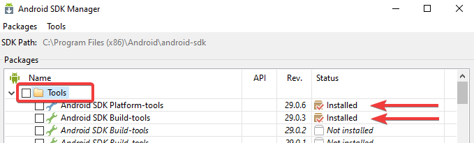

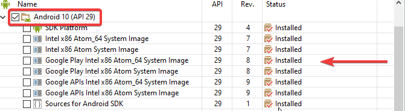

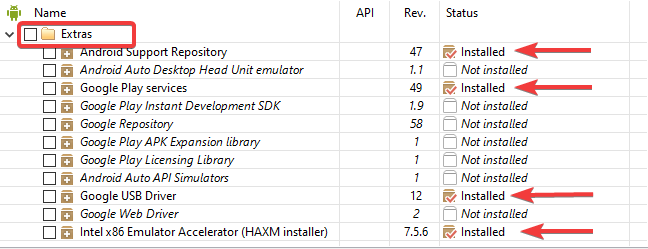

Modifiez les ```variables d'environnement Windows``` pour le SDK Manager :

* Affichez la fenêtre de modification des variables d'environnement système :
  * Paramètres Windows > Système > Informations système > Informations système > Paramètres système avancés > Cliquez sur le bouton "Variables d'environnement" > zone "Variables système" 

* Modifiez la variable d'environnement système ```Path``` :
  * sélectionnez la variable ```Path``` > "```Modifier```" > ajouter une nouvelle valeur ```Nouveau``` :
      ```
      C:\Program Files (x86)\Android\android-sdk
      ```
  * Déplacez cette nouvelle valeur ```au début de la liste```

* Ajoutez une variable d'environnement système ```ANDROID_HOME``` :
  * Sous la zone "Variables système", cliquez sur "```Nouvelle...```"
  * Nom de la variable : ```ANDROID_HOME```
  * Valeur de la variable : ```C:\Program Files (x86)\Android\android-sdk```

* Ajoutez une variable d'environnement système ```ANDROID_SDK_ROOT``` :
  * Sous la zone "Variables système", cliquez sur "```Nouvelle...```"
  * Nom de la variable : ```ANDROID_SDK_ROOT```
  * Valeur de la variable : ```C:\Program Files (x86)\Android\android-sdk```

**Redémarrez Windows**


# 2. Installation de l'extension VScode pour Cordova
Lancez VScode. Dans la barre d'activité à gauche, cliquez sur l'icône ```Extensions```.


Aidez vous de la barre de recherche pour trouver et installer l'extension suivante :

* Cordova Tools (Microsoft)

Dans les résultats de recherche, cliquez sur l'extension désirée et dans la fenêtre de droite, cliquez sur ```install```

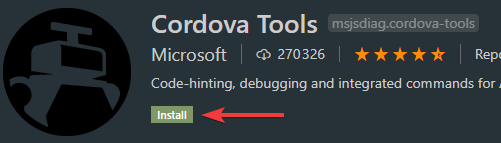


# 3. Création d'un projet Cordova

## 3.1 Création de l'architecture du projet

> Cordova possède une commande console (CLI) qui permet de créer un projet avec une arborescence de base.

Dans un terminal, naviguez jusqu'au dossier qui contiendra le projet. Par exemple ```I:\temp```

Créez le projet cordova qui aura pour nom ```ProjetHello``` avec la commande suivante:

**```cordova create ProjetHello```**

Ce qui donne :
```shell
I:\temp>cordova create ProjetHello
Creating a new cordova project.
```

Le projet est créé dans le dossier :
```shell
I:\temp\ProjetHello
```
Le dossier du projet ```ProjetHello``` contient l'arborescence suivante :

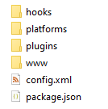

Le sous dossier ```ProjetHello\www``` contient l'arborescence du site web embarqué dans l'appli finale :

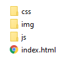

## 3.2 Création de la plateforme android

> Pour le moment, le sous dossier ```ProjetHello\platforms``` ne contient rien. 
Il faut y créer la plateforme Android.

Dans un terminal, déplacez vous jusque **dans** le dossier du projet ```I:\temp\ProjetHello```, et tapez la commande suivante :

**```cordova platform add android```**

Ce qui donne :
```shell
I:\temp>cd ProjetHello
I:\temp\0\ProjetHello>cordova platform add android
Using cordova-fetch for cordova-android@^9.0.0
Adding android project...
Creating Cordova project for the Android platform:
        Path: platforms\android
        Package: io.cordova.hellocordova
        Name: HelloCordova
        Activity: MainActivity
        Android target: android-29
Subproject Path: CordovaLib
Subproject Path: app
Android project created with cordova-android@9.0.0
Installing "cordova-plugin-whitelist" for android
```
Maintenant le sous dossier ```ProjetHello\platforms``` contient la plateforme android. Le sous dossier ```ProjetHello\platforms\android``` contient l'arborescence suivante :

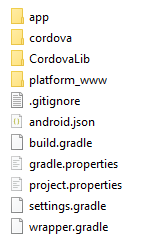


# 4. Edition du projet dans VS Code

Ouvrez le dossier contenant le projet ```I:\temp\ProjetHello``` avec VScode pour avoir accès au code source.

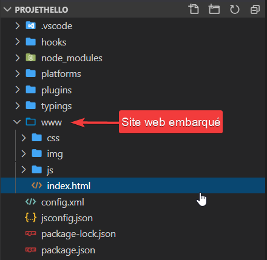


# 5. Déploiement de l'application sur un smartphone Android

## 5.1 Création de l'application android (BUILD)
Dans VScode, créez l'application android en utilisant la commande "```Cordova: Build```" depuis la palette de commande (F1)

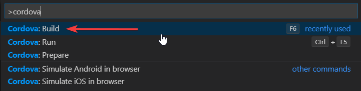

**Attention : le premier déploiement prend du temps**. 

> Cordova utilise Gradle pour construire le projet.
La premier lancement de Gradle télécharge et installe un "wrapper" pour Cordova dans %userprofile%/.gradle (version de Gradle correspondant à la version de Cordova). Ce wrapper n'est téléchargé qu'une seule fois. Les autres projets Cordova utiliseront le même wrapper.

Le fichier exécutable android se situe dans le sous dossier du projet :
```
\platforms\android\app\build\outputs\apk\debug\app-debug.apk
```

## 5.2 Configurer le smartphone pour le debug
Activez le mode debug sur votre smartphone android :
* Activez les options de développement sur le smartphone (ça dépend des smartphones, cherchez sur Google pour le votre)


* Paramètres > Options de développement > Activé : OUI
* Paramètres > Options de développement > Débogage USB : Activé
* Paramètres > Options de développement > Installer via USB : Activé
* Paramètres > Options de développement > Vérifier applications via USB : Activé

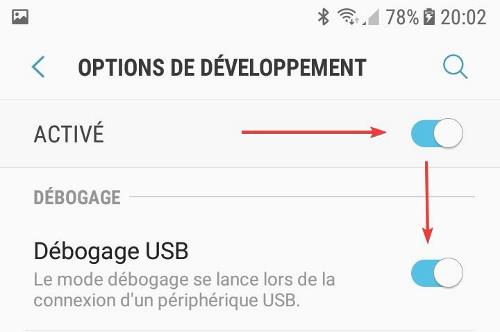

Branchez en USB votre smartphone sur l'ordinateur de développement. 
* Activez le transfert de fichier par USB
* Attendre que windows configure les drivers d'accès au smartphone

## 5.3 Installation de l'appli et lancement sur un smartphone (RUN)
Dans VScode, déployez l'application android en utilisant la commande "```Cordova: Run```" depuis la palette de commande (F1)

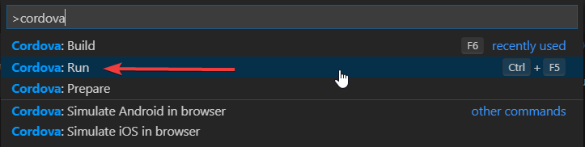

* La première fois que vous utiliser un smartphone pour le debug, le smartphone doit afficher une demande d'autorisation pour le débogage USB : Toujours autoriser sur cet ordinateur > OK

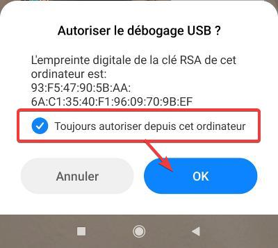

* Recommencez ```Cordova: Run```
* autorisez l'installation via USB

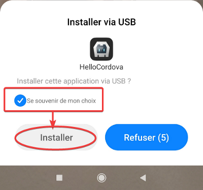

> Si vous avez l'**erreur "input,keyevent,82"**, c'est que l'appli est déjà installée sur le smartphone : désinstallez là avant de recommencer

> Certains ordis ont besoin d'une connexion USB récente pour que ça fonctionne : préférez une prise USB3 (c'est le cas sur les ordis des salles de TP, utilisez les ports USB à l'arrière des ordis)

L'appli est installée sur le smartphone (si vous l'autorisez à nouveau sur le smartphone). Si elle ne se lance pas automatiquement, trouvez l'icône cordova avec le nom "HelloCordova" et cliquez dessus.

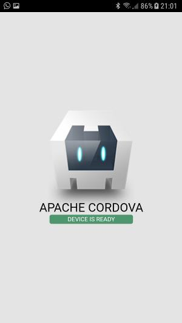

# 6. Accès à une API Web distante depuis l'application cordova
Les accès aux API se font en utilisant la technique ```AJAX standard```.

Cependant, il faut autoriser les accès HTTP distants et cette autorisation doit être inclue dans le "manifest" de l'appli android.

Pour autoriser les accès HTTP distants :
1. Editez le fichier **```/config.xml```** qui est directement sous la racine du projet
   * Après la ligne ```<access origin="*" />```, ajoutez les 2 lignes suivantes :
    ```xml
    <allow-navigation href="*" />
    <allow-intent href="*" />
    ```

2. Vérifiez que le plugin ```cordova-plugin-whitelist``` est ajouté au projet cordova (il doit être présent dans le dossier /plugins)
   
3. Editez le fichier **```/www/index.html```**
   * Modifiez la balise ```<meta http-equiv="Content-Security-Policy" ... >``` en ajoutant la propriété ```connect-src``` et en modifiant sa valeur par le nom de domaine de l'API. Ce qui donne :
      ```html
      <meta http-equiv="Content-Security-Policy" content="default-src 'self' data: gap: https://ssl.gstatic.com 'unsafe-eval'; connect-src 'self' http://xxxx.alwaysdata.net/; style-src 'self' 'unsafe-inline'; media-src *; img-src 'self' data: content:;">
      ```

4. Recréez la plateforme android
   * Supprimez le sous-dossier ```/platforms/android```
   * Regénérez la plateform android :
    ```sh
    cordova platform add android
    ```

5. Pour les accès aux API en HTTP (n'utilisant pas HTTPS), il faut éditer le fichier ```/platforms/android/app/src/main/AndroidManifest.xml``` et modifier l'élément XML ```<application>``` en lui ajoutant l'attribut ```android:usesCleartextTraffic="true"```. Ce qui donne, par exemple :
    ```xml
    <application android:hardwareAccelerated="true" android:icon="@mipmap/ic_launcher" android:label="@string/app_name" android:supportsRtl="true" android:usesCleartextTraffic="true">
    ```
   
6. Configurez l'**```API web```** 
   * Il faut que l'API web (=serveur web) ajoute les en-têtes HTTP qui permettent au navigateur (webview inclue dans l'appli cordova) d'autoriser les requêtes ```multi-origine (cross-origin)```

    > ### Cross-origin resource sharing (CORS)
    > Le «  Cross-origin resource sharing » (CORS) ou « partage des ressources entre origines multiples » (en français, moins usité) est un mécanisme qui consiste à ajouter des en-têtes HTTP afin de permettre à un agent utilisateur d'accéder à des ressources d'un serveur situé sur une autre origine que le site courant. Un agent utilisateur réalise une requête HTTP multi-origine (cross-origin) lorsqu'il demande une ressource provenant d'un domaine, d'un protocole ou d'un port différent de ceux utilisés pour la page courante. ([*Voir documentation sur MDN*](https://developer.mozilla.org/fr/docs/Web/HTTP/CORS))

   * Pour une ```API web écrite en PHP``` et hébergée sur un serveur Apache, il faut ajouter aux réponses HTTP :

      ```php
      header('Access-Control-Allow-Origin: *');
      header('Access-Control-Allow-Headers: Authorization, Content-Type');
      header('Access-Control-Allow-Methods: GET, POST, PUT, DELETE, OPTIONS');
      ```

   * Pour une ```API REST créée avec le framework CodeIgniter 4+```, suivez les explications du site [mfikri.com](https://mfikri.com/en/blog/codeigniter4-restful-api) à partir du Step #8

# 7. Plugins
Les plugins permettent d'étendre les fonctionnalités d'une appli cordova.

Les plugins contiennent du code natif pour les platformes android ou ios et une interface javascript. On peut donc avoir accès aux fonctionnalités du téléphone (stockage, bluetooth, ...)

On peut rechercher un plugin :
* sur [cordova.apache.org/plugins/](https://cordova.apache.org/plugins/) - pas toujours très bien classé ...
* sur [www.npmjs.com](https://www.npmjs.com/) en intégrant dans la recherche "cordova". L'avantage est d'avoir accès à la popularité et qualité des plugins. 

> Faites votre choix en n'oubliant pas de vérifier si la documentation du plugin est suffisamment étoffée et/ou s'il y a des exemples de codage.

Exemple de plugins trouvés sur npmjs.com en recherchant "cordova bluetooth le" :
* [cordova-plugin-ble-central](https://www.npmjs.com/package/cordova-plugin-ble-central)
* [cordova-plugin-bluetoothle](https://www.npmjs.com/package/cordova-plugin-bluetoothle)

L'installation des plugin se fait en mode terminal dans le dossier du projet :
```
cordova plugin add xxxxxxxx
```

# 8. Emulateur android

* Création d'un périphérique virtuel avec Android Virtual Device Manager (AVD Manager)
* Utilisation de l'émulateur Android dans VS Code

Reste à finir...