# VScode pour coder en C++ sur un Raspberry distant

> * Auteur : Gwénaël LAURENT
> * Remerciements : Merci à Alix pour l'extension IBgenerator
> * Date : 20/10/2021
> * OS : Windows 10 (version 20H2)
> * VScode : version 1.60.0 (system setup)

 [Licence Creative Commons](https://creativecommons.org/licenses/by-nc-sa/3.0/fr/)


- [VScode pour coder en C++ sur un Raspberry distant](#vscode-pour-coder-en-c-sur-un-raspberry-distant)
- [1. Objectif](#1-objectif)
- [2. Pré-requis à installer](#2-pré-requis-à-installer)
- [3. Dans VScode, se connecter au Raspberry distant](#3-dans-vscode-se-connecter-au-raspberry-distant)
  - [3.1. La connexion](#31-la-connexion)
  - [3.2. La déconnexion](#32-la-déconnexion)
- [4. Créer un projet C++ sur le Raspberry](#4-créer-un-projet-c-sur-le-raspberry)
  - [4.1. Création du dossier du projet](#41-création-du-dossier-du-projet)
  - [4.2 Installer les extensions VScode sur le Raspberry](#42-installer-les-extensions-vscode-sur-le-raspberry)
  - [4.3 Création de la structure du projet C++](#43-création-de-la-structure-du-projet-c)
- [5. Construire et lancer le programme](#5-construire-et-lancer-le-programme)
- [6. Débuguer le programme](#6-débuguer-le-programme)
- [7. Télécharger le projet C++ sur l'ordi Windows](#7-télécharger-le-projet-c-sur-lordi-windows)
- [8. Utiliser la bibliothèque WiringPi](#8-utiliser-la-bibliothèque-wiringpi)
  - [8.1. C'est quoi WiringPi](#81-cest-quoi-wiringpi)
  - [8.2. Branchement du blink](#82-branchement-du-blink)
  - [8.2. Code source du blink](#82-code-source-du-blink)
  - [8.3. makefile : paramétrer la compilation](#83-makefile--paramétrer-la-compilation)
  - [8.4. Exécuter le programme](#84-exécuter-le-programme)
- [9. Fermer correctement VScode](#9-fermer-correctement-vscode)
- [10. Création d'une classe avec l'assistant](#10-création-dune-classe-avec-lassistant)
  - [10.1 Création de la classe](#101-création-de-la-classe)
  - [10.2 Ajout d'une méthode à la classe](#102-ajout-dune-méthode-à-la-classe)
  - [10.3 Utilisation de la classe dans le main](#103-utilisation-de-la-classe-dans-le-main)

> Documentation officielle ["Remote Development using SSH"](https://code.visualstudio.com/docs/remote/ssh)


# 1. Objectif
L'objectif est d'utiliser un ordi de développement Windows  pour coder et déboguer des programmes **sur un Raspberry**.

VScode propose des extensions qui permettent de faire du développement à distance grâce au **```protocole SSH```** ([Wikipédia Secure Shell](https://fr.wikipedia.org/wiki/Secure_Shell))

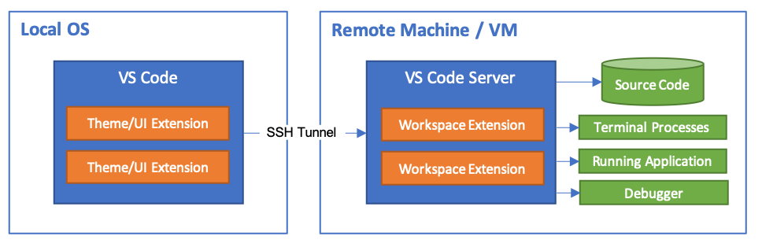

# 2. Pré-requis à installer

> cf [VScode pour coder à distance (en utilisant SSH)](vscode-remote.md)

Sur le Raspberry, il faut installer un serveur SSH : **c'est déjà fait par défaut sur les distributions Raspbian** et configurer le serveur SSH pour que l'utilisateur root puisse se connecter.

> cf [Gitlab > Chifrement des communications avec SSH](../gitlab/readme.md#4-chifrement-des-communications-avec-ssh)

Sur l'ordi Windows, il faut avoir installé le client SSH de Microsoft et avoir créé une paire de clés SSH : ```ssh-keygen```

> cf [VScode pour coder à distance (en utilisant SSH) > 2. Installation du client SSH pour Windows](vscode-remote.md#2-installation-du-client-ssh-pour-windows)


Sur l'ordi Windows, dans VScode, il faut installer les extensions :
* C/C++ (Microsoft)
* C++ Helper (amir)
* IBGenerator (ProfesseurIssou)
* Remote Development (Microsoft) - *pack d'extensions*

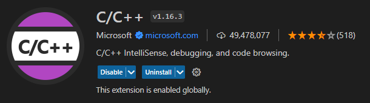

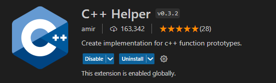


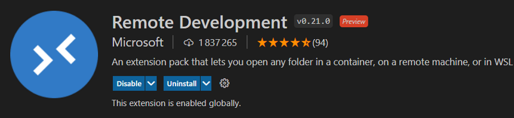

> cf [VScode pour coder du C++ (appli console Windows)](vscode-cpp-mingw64.md#3-installation-des-extensions-dans-vscode)

> cf [VScode pour coder à distance (en utilisant SSH) > 3. Installation des extensions dans VScode](vscode-remote.md#3-installation-des-extensions-dans-vscode)

# 3. Dans VScode, se connecter au Raspberry distant

> IMPORTANT : Vérifiez que vous avez une paire de clés SSH sur votre ordinateur. Si c'est le cas, elles se trouvent dans le dossier de votre profil local : ```C:\Users\VOTRE_LOGIN\.ssh``` et s'appellent ```id_rsa``` et ```id_rsa.pub```. Si ces 2 fichiers n'existent pas, créez les avec la commande console ```ssh-keygen```

## 3.1. La connexion
Il faut enregistrer une nouvelle connexion distante pour votre raspberry.

Cliquez sur ```Remote explorer```  dans la barre d'activité, puis dans la zone "```SSH TARGETS```", cliquez sur le "```+```"

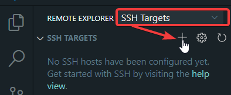

Les informations à fournir sont les suivantes :
* L'utilisateur et l'adresse IP de la machine distante : par exemple **```ssh root@172.16.0.57```**
* L'emplacement du fichier de config à utiliser pour enregistrer cette connexion. Le plus sécurisé est de choisir le dossier de profil de l'utilisateur : ```C:\users\gwenael\.ssh\config```

Dans la zone ```SSH TARGETS``` de ```Remote explorer```  vous verrez apparaitre la connexion sauvegardée.

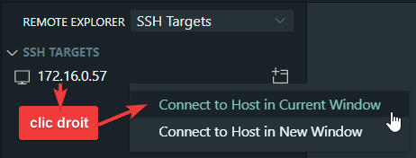

Clic droit sur la connexion pour vous connecter à l'hôte distant "**```Connect to Host in Current Window```**".\
Il faut ensuite saisir les infos suivantes (en haut de l'écran VScode) :
* sélectionnez le système d'exploitation distant (linux)
* enregistrez l'identification de la machine distante (fingerprint ... > Continue)
* saisissez le mot de passe de l'utilisateur distant 
* après un instant, VScode est connecté à la machine distante.

> Si la connexion ne veut pas s'établir (erreur) il se peut que l'identication de la machine distante (fingerprint) ait changé par rapport à celle qui est enregistrée sur votre ordinateur. Dans ce cas supprimer l'ancienne ligne correspondant à la machine distante dans le fichier ```C:\Users\gwenael\.ssh\known_hosts```

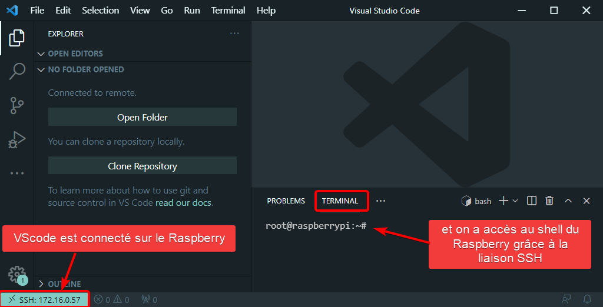

## 3.2. La déconnexion
Pour se déconnecter du Raspberry :
* Cliquez sur "Open Remote Window"  dans la barre de status et sélectionnez "```Close Remote Connection```" en haut de l'écran de VScode
* ou File > Close Remote Connection
* ou fermez VScode.

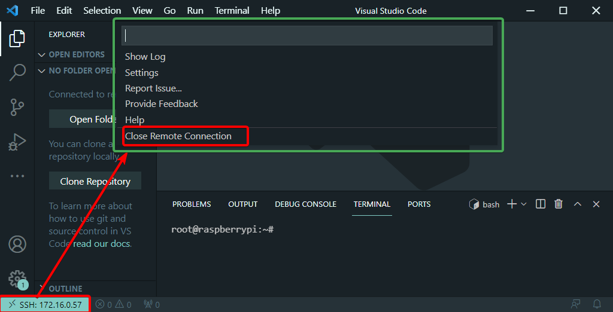

# 4. Créer un projet C++ sur le Raspberry
## 4.1. Création du dossier du projet
> Quand vous êtes connectés Raspberry, le terminal de VScode est celui de la machine distante (c'est une console linux via SSH).
> Vous êtes directement dans le dossier personnel de l'utilisateur distant ```/root``` (si vous êtes connectés en root) 

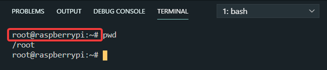

Dans le terminal de VScode, créez un dossier pour le projet de dév. : 

```shell
mkdir projet-test
```

Dans la barre d'activité, cliquez sur l'icône "Explorer" , puis cliquez sur **```Open Folder```** pour sélectionner le dossier du projet distant à ouvrir dans VScode.

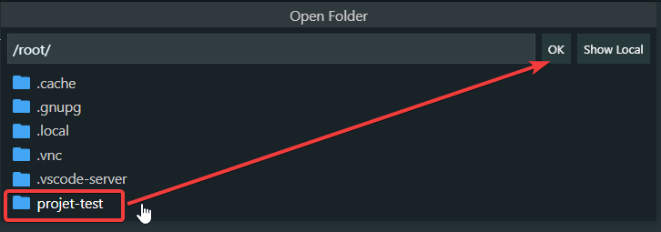

Il faut refournir le mot de passe de l'utilisateur distant pour voir les fichiers du dossier (il n'y a rien pour l'instant):

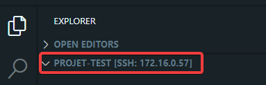

## 4.2 Installer les extensions VScode sur le Raspberry
Dans la barre d'activité > Extensions, les 3 extensions suivantes doivent apparaître dans la partie des extensions VScode déjà installées sur le Raspberry :
* C/C++ (Microsoft)
* C++ Helper (amir)
* IBGenerator (ProfesseurIssou)

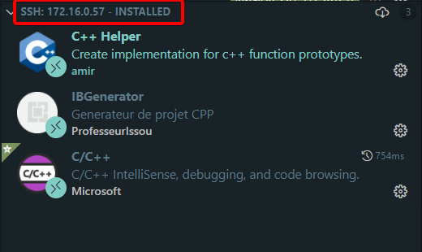

Si ce n'est pas le cas, dans la barre d'activité > Extensions, sélectionnez ces 3 extensions et installez les sur l'hôte distant : cliquez sur ```Install in SSH:xxxxx```

   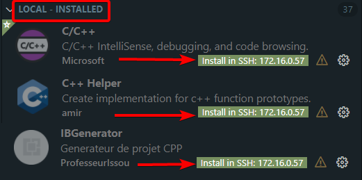


## 4.3 Création de la structure du projet C++
Dans la palette de commande (**```F1```**) cherchez et sélectionnez "**```IBGenerator : Create new C++ project```**" > Sélectionnez ensuite "**```[G++/GDB] Linux```**"

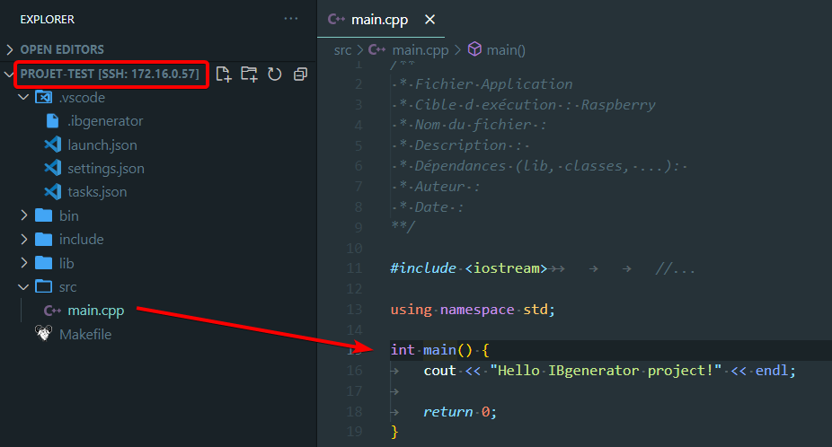

# 5. Construire et lancer le programme
Dans la barre de statut de VScode (en bas), cliquez sur ```Build``` pour compiler et créer l'exécutable (/bin/main)

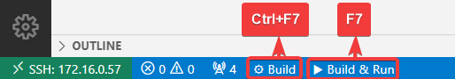

Cliquez sur ```Build & Run``` pour compiler, construire l'exécutable et lancer le programme dans le terminal intégré à VScode.

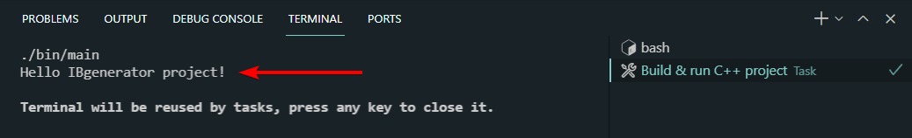

# 6. Débuguer le programme
> **IMPORTANT** : Vérifiez, et modifiez si nécessaire, la valeur d'une ligne du fichier de debug ```/.vscode/launch.json``` (*Formattage du document : **```Alt+Shift+F```***)
  ```
  "externalConsole": false,
  ```

Modifiez le programme ```main.cpp``` comme ceci :
```cpp
#include <iostream>				//...

using namespace std;

int main() {
	string nom = "";
	cout << "Votre nom : ";
	cin >> nom;
	cout << "Bonjour " << nom << endl;
	return 0;
}
```
Mettez un ```point d'arrêt``` sur la ligne du dernier cout.

Lancez le debug avec **```F5```** ou à partir de la barre d'activité (Il faut quelques secondes pour que le debug s'initialise, on voit les messages dans l'onglet "Debug console")

Affichez le terminal distant :

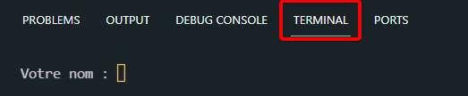

Dans le terminal de VScode, saississez votre nom puis Entrée : le programme s'arrête sur le point d'arrêt

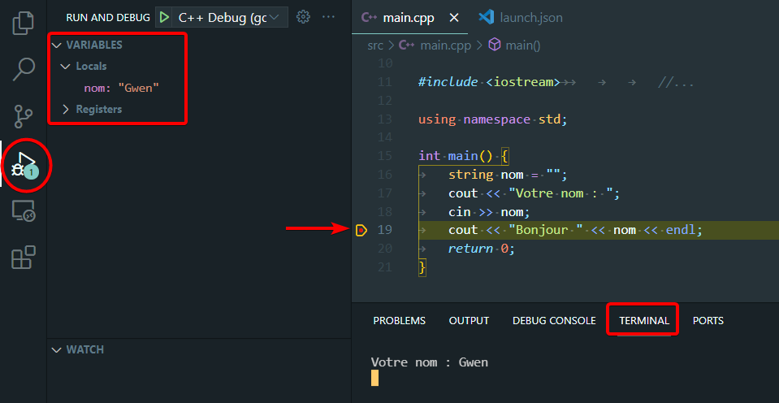

# 7. Télécharger le projet C++ sur l'ordi Windows
Dans l'explorateur de fichier de VScode : Clic gauche en dehors des fichiers (donc aucun fichier sélectionné) puis clic droit > Download.

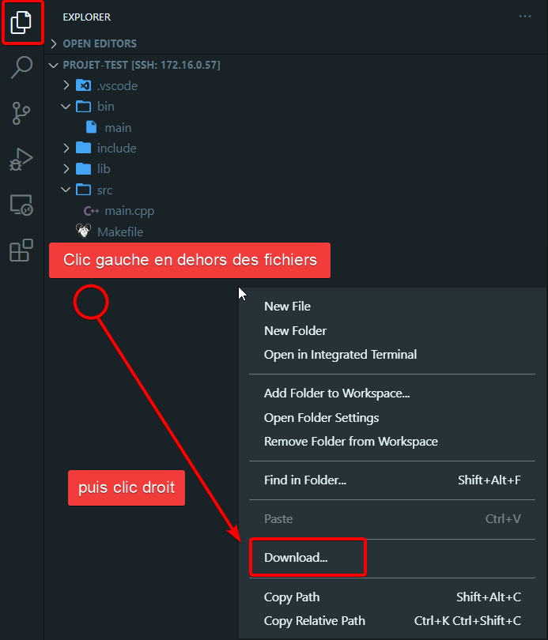

# 8. Utiliser la bibliothèque WiringPi

## 8.1. C'est quoi WiringPi
WiringPi est une bibliothèque qui permet d’accéder aux Entrées / Sorties du Raspberry (GPIO). Elle est installé par défaut sur les distributions Raspian

> WiringPi fournit un utilitaire console qui permet de connaitre la numérotation des broches du GPIO : ```gpio readall```

* La documentation officielle : [wiringpi.com](http://wiringpi.com/)
* La documentation officielle : [les fonctions](http://wiringpi.com/reference/core-functions/)
* La documentation officielle : [L'exemple Blink](http://wiringpi.com/examples/blink/)
* Une documentation en français : [wiki.mchobby.be](https://wiki.mchobby.be/index.php?title=Pi-WiringPi)

## 8.2. Branchement du blink
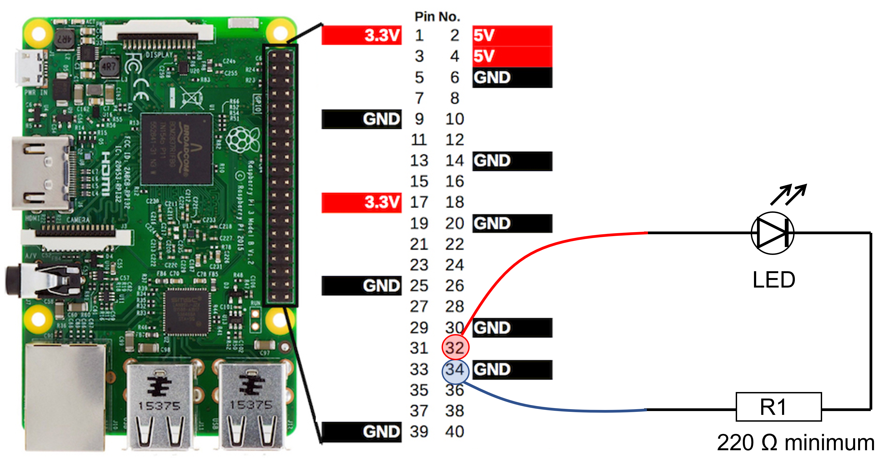

La broche n°32 du GPIO physique correspond au n°26 pour la bibliothèque WiringPi.
Vous pouvez le vérifier avec l'utilitaire ```gpio readall```.

## 8.2. Code source du blink
```cpp
#include <wiringPi.h>
#define LED_PIN 26
using namespace std;

int main() {
    wiringPiSetup();
    pinMode(LED_PIN, OUTPUT);
    while (true) {
        digitalWrite(LED_PIN, HIGH);
        delay(1000);
        digitalWrite(LED_PIN, LOW);
        delay(500);
    }
    return 0;
}
```
## 8.3. makefile : paramétrer la compilation
Il faut donner des instructions supplémentaires au compilateur pour qu'il utilise les bibliothèques WiringPi (-lwiringPi) et pthread (-lpthread).

> **ATTENTION** : un fichier Makefile suit des règles très strictes de syntaxe. Les tabulations sont à préserver ! Absolument ! [Quelques infos ici](https://sites.uclouvain.be/SystInfo/notes/Outils/make.html)

Dans le fichier /Makefile (à la racine du projet C++), ajoutez les 2 bibliothèques à la variable CXX_FLAGS (2ème ligne du fichier). Ce qui donne :
```makefile
CXX		  := g++
CXX_FLAGS := -Wall -Wextra -std=c++17 -ggdb -lwiringPi -lpthread
```

## 8.4. Exécuter le programme
Dans la barre de statut de VScode (en bas), cliquez sur ```Build & Run``` (ou F7) pour compiler, construire l'exécutable et lancer le programme dans le terminal intégré à VScode.

Arrêtez le programme avec ```Ctrl+C``` dans le terminal.

# 9. Fermer correctement VScode
Menu principal de VScode :
* File > **```Close Remote Connection```**


# 10. Création d'une classe avec l'assistant
## 10.1 Création de la classe
Dans la palette de commande (**```F1```**) cherchez et sélectionnez "**```IBGenerator : Create new class```**"

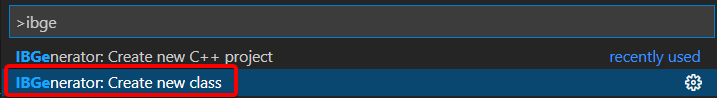

Sélectionnez la création automatique du constructeur par défaut et du destructeur

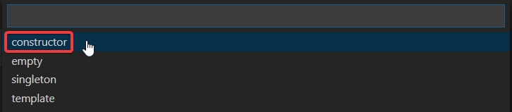

Donnez un nom à votre classe (ici, la classe Personne) puis Entrée

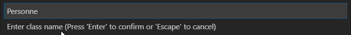

Les deux fichiers de la classe sont créés dans les bons dossiers :
* **```Personne.hpp```** (interface de la classe) dans le dossier ```include```
* **```Personne.cpp```** (implémentation de la classe) dans le dossier ```src```

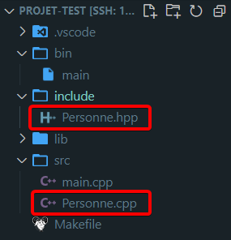

Contenu de ``` Personne.hpp``` :
```cpp
/**
 * Fichier Interface de la classe
 * Nom du fichier : 
 * Nom de la classe : 
 * Description : 
 * Auteur : 
 * Date :
**/

#pragma once

class Personne {

public:
	Personne();
	~Personne();
};
```

Contenu de ``` Personne.cpp``` :
```cpp
/**

 * Fichier Implémentation de la classe
 * Nom du fichier : 
 * Nom de la classe : 
 * Description : 
 * Auteur : 
 * Date : 
**/

#include "Personne.hpp"

// Constructeur
Personne::Personne() {

}

// Destructeur
Personne::~Personne() {

}
```

> Vous pouvez facilement passer de l'édition du fichier .hpp (interface) au fichier .cpp (implémentation) et inversement avec un clic droit dans le code source > **```Switch Header/Source```** (ou **```Alt + O```**)
> 
> 

## 10.2 Ajout d'une méthode à la classe
Editez le code source de l'interface ``` Personne.hpp```. Ajoutez :
* les directives d'include et de namespace
* les modificateurs d'accès (private et public)
* l'attribut ```string nom```
* la méthode ```string LireNom()```

```cpp
#pragma once
#include <iostream>
using namespace std;

class Personne {

private:
    string nom = "Gwénaël Laurent";
public:
    Personne();
    ~Personne();
    string LireNom();
};
```

Pour créer l'implémentation de la méthode LireNom, il suffit de faire un clic droit sur le nom de la méthode > **```Create Implementation```**


Il ne reste plus qu'à coder le contenu de cette fonction dans ``` Personne.cpp```

```cpp
string Personne::LireNom() 
{
    return nom;
}
```

## 10.3 Utilisation de la classe dans le main
Dans ```main.cpp```, ajoutez :
* la directive d'include de la classe
* la création d'un objet de la classe Personne
* l'appel de la méthode LireNom()
* L'affichage du nom

```cpp
#include <iostream>
#include "Personne.hpp"
using namespace std;

int main()
{
    string msg = "Bonjour ";
    Personne objPers;
    cout << msg << objPers.LireNom() << endl;
    return 0;
}
```

Lancez en debug votre programme avec un point d'arrêt après la création de l'objet Personne.

L'inspecteur de variables permet d'inspecter le contenu des objets :

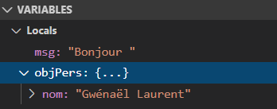