# VScode pour coder du C++ (appli console Windows)

> * Auteur : Gwénaël LAURENT
> * Remerciements : Merci à Alix pour l'extension IBgenerator
> * Date : 31/07/2023
> * OS : Windows 10 (version 22H2)
> * VScode : version 1.80.0 (system setup)
> * Node.js : version 18.17.0
> * MinGW-w64 : installé avec MSYS2

 [Licence Creative Commons](https://creativecommons.org/licenses/by-nc-sa/3.0/fr/)

- [VScode pour coder du C++ (appli console Windows)](#vscode-pour-coder-du-c-appli-console-windows)
- [1. Objectifs](#1-objectifs)
- [2. Installation des extensions dans VScode](#2-installation-des-extensions-dans-vscode)
- [3. Installation de la chaine de compilation MinGW-w64](#3-installation-de-la-chaine-de-compilation-mingw-w64)
  - [3.1 Téléchargement de MinGW-w64](#31-téléchargement-de-mingw-w64)
  - [3.2 Installation de MinGW-w64](#32-installation-de-mingw-w64)
  - [3.3 Création du fichier make.exe](#33-création-du-fichier-makeexe)
  - [3.4 Ajout de minGW dans le Path système](#34-ajout-de-mingw-dans-le-path-système)
  - [3.5 Testez l'installation de minGW-w64](#35-testez-linstallation-de-mingw-w64)
  - [3.6 Mettre à jour minGW-w64](#36-mettre-à-jour-mingw-w64)
- [4. Création d'un projet C++](#4-création-dun-projet-c)
  - [4.1 Création du projet](#41-création-du-projet)
  - [4.2 Présentation de l'architexture du projet C++](#42-présentation-de-larchitexture-du-projet-c)
- [5. Construire l'exécutable (build)](#5-construire-lexécutable-build)
- [6. Construire et exécuter (build and run)](#6-construire-et-exécuter-build-and-run)
- [7. Debuguer avec point d'arrêt](#7-debuguer-avec-point-darrêt)
- [8. Création d'une classe C++ avec l'assistant](#8-création-dune-classe-c-avec-lassistant)
  - [8.1 Création de la classe](#81-création-de-la-classe)
  - [8.2 Ajout d'un attribut et d'une méthode à la classe](#82-ajout-dun-attribut-et-dune-méthode-à-la-classe)
  - [8.3 Utilisation de la classe dans la fonction main](#83-utilisation-de-la-classe-dans-la-fonction-main)

# 1. Objectifs
L'objectif est de configurer VScode pour créer des applications Windows "Console" en langage C++. Les applis consoles sont utilisables dans une CLI (Command-Line Interface = "Invite de commandes"), mais ne génère pas de GUI (Graphical User Interface = des fenêtres graphiques).

Pour coder du C++ avec VScode sous Windows, il faut installer :
* Des extensions VScode
* Une chaine de compilation C++ pour Windows

La **chaine de compilation C++** choisie est **MinGW-w64**. Cela permet d'avoir les outils C++ de Linux disponibles sous Windows (les logiciels libres gcc, g++, make, gdb).

# 2. Installation des extensions dans VScode
Lancez VScode. Dans la barre d'activité à gauche, cliquez sur l'icône ```Extensions```.


Aidez vous de la barre de recherche pour trouver et installer les extensions suivantes :

* C/C++ (Microsoft)
* C++ Helper (amir)
* IBGenerator (ProfesseurIssou)

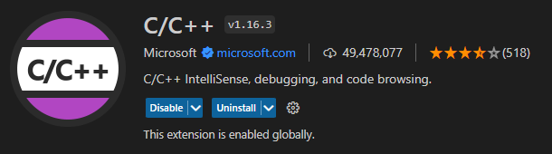

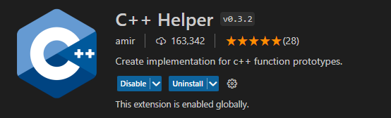


Dans les résultats de recherche, cliquez sur l'extension désirée et dans la fenêtre de droite, cliquez sur ```install```. Redémarrez VScode si nécessaire.


# 3. Installation de la chaine de compilation MinGW-w64
> Une chaine de compilation C++ (**C++ toolchain**) est un ensemble de logiciels et de bibliothèques logicielles qui permet de créer d'autres logiciels en utilisant le langage C++.

> **MinGW-w64** (Minimalist GNU for Windows x64) est une adaptation des logiciels de développement et de compilation du GNU à la plate-forme Windows (GCC = GNU Compiler Collection).

Documentation officielle d'installation : [Using GCC with MinGW](https://code.visualstudio.com/docs/cpp/config-mingw)


## 3.1 Téléchargement de MinGW-w64
La dernière version de MinGW-w64 se télécharge via MSYS2, qui fournit des versions natives à jour de MinGW-w64.

* Rendez vous sur le site MSYS2 : [www.msys2.org](https://www.msys2.org/)
* Cliquez sur "Download the installer" : msys2-x86_64-20230718.exe


## 3.2 Installation de MinGW-w64
Double-cliquez sur le fichier téléchargé  ```msys2-x86_64-20230718.exe``` pour lancer l'installation :
* Dossier d'installation : C:\msys64
* Raccourcis du menu démarrer : MSYS2
* Exécution de l'assistant de MSYS2 : cochez "**Exécutez MSYS2 maintenant**" et cliquez sur Terminer

Le terminal MSYS2 se lance en utilisant l'environnement "UCRT64" (environnement par défaut avant la configuration).

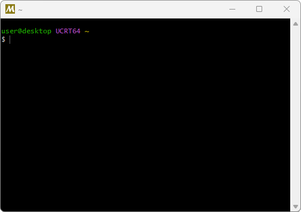

Dans ce terminal, il faut installer MinGW-w64 en saisissant cette commande :
```
pacman -S mingw-w64-ucrt-x86_64-gcc
```
* Proceed with installation ? [Y/n] : Y puis Entrée

Toujours dans le terminal MSYS2 , il faut maintenant installer la chaine d'outils Mingw-w64 en saisissant cette commande :
```
pacman -S --needed base-devel mingw-w64-x86_64-toolchain
```

* Enter a selection (default=all): appuyez sur Entrée pour installer tous les membres du groupe.
* Proceed with installation ? [Y/n] : Y puis Entrée

Vous pouvez maintenant fermer le terminal MSYS2.


## 3.3 Création du fichier make.exe
> Le logiciel ```make``` est utilisé pour l’automatisation des tâches de compilation et de linkage. [Un peu de documentation ici](http://eric.bachard.free.fr/UTBM_LO22/P07/C/Documentation/C/make/intro_makefile.pdf)

La construction d'un exécutable grâce au logiciel ```make``` est disponible dans MinGW-w64 mais ne porte pas le bon nom pour être utilisé automatiquement par les extensions de VScode. Vous allez donc en faire une copie avec le bon nom **```make.exe```**

Dans une invite de commandes Windows, à l'emplacement ```C:\msys64\mingw64\bin```, tapez :
```shell
> copy mingw32-make.exe make.exe
```

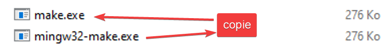


## 3.4 Ajout de minGW dans le Path système
Affichez la fenêtre de modification des **variables d'environnement système** :
  * Touche Windows > recherchez "variables" > Cliquez sur "Modifier les variables d'environnement système" > Cliquez sur le bouton "Variables d'environnement" 

Dans la zone "```Variables système```" :
* Sélectionnez la variable ```Path``` > "```Modifier```"

  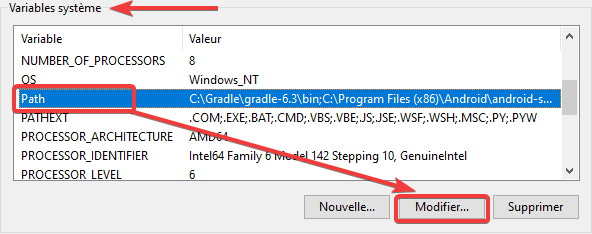

* Ajoutez une nouvelle valeur en cliquant sur ```Nouveau``` :
    ```
    C:\msys64\mingw64\bin
    ```
* Déplacez la nouvelle valeur en haut de la liste (mais juste après les 2 lignes Python311 si vous avez déjà installé Python)
  
  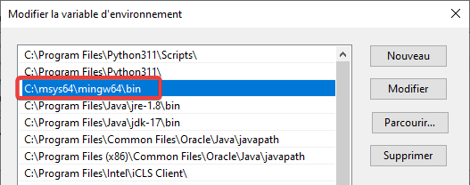

* Fermez la fenêtre avec ```OK```


## 3.5 Testez l'installation de minGW-w64
Vérifiez que la toolchain C++ est bien disponible dans Windows : Ouvrez une **nouvelle fenêtre d'invite de commandes** (*ne pas utiliser une fenêtre de terminal déjà ouverte car les modifications des variables d'environnements ne seront pas prises en compte*).

Les commandes suivantes doivent retourner le numéro de leur version :

```shell
gcc --version
g++ --version
gdb --version
make --version
```

## 3.6 Mettre à jour minGW-w64
Pour installer les mises à jour de minGW-w64 il faut absolument passer par le terminal MSYS2.

Démarrer une console MSYS2 : Touche Windows > "MSYS2 MSYS"

Pour mettre à jour tous les packages, exécutez la commande suivante :
```shell
pacman -Suy
```

Dans certains cas, certains packages de base seront mis à jour et pacman vous demandera de fermer tous les terminaux :

```shell
:: To complete this update all MSYS2 processes including this terminal will be closed.
   Confirm to proceed [Y/n]
```

Après avoir confirmé, vous devez démarrer un nouveau terminal et exécuter à nouveau la mise à jour ( ```pacman -Suy```) pour mettre à jour les packages non essentiels restants.

> Après mise à jour de minGW, il ne faut pas oublier de recréer la nouvelle version de C:\msys64\mingw64\bin\make.exe (cf [3.3 Création du fichier make.exe](#33-création-du-fichier-makeexe))


# 4. Création d'un projet C++
## 4.1 Création du projet
Dans l'explorateur de fichier Windows, créez un dossier pour votre projet C++. Par exemple :
```
I:\temp\ProjetCpp
```
Ouvrez ce projet dans VScode (Clic droit sur le dossier > Ouvrir avec Code )


Dans la palette de commande (**```F1```**) cherchez et sélectionnez "**```IBGenerator : Create new C++ project```**"

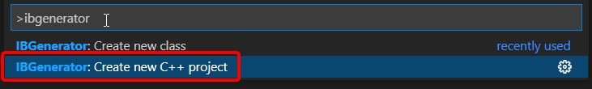

Sélectionnez ensuite "**```[G++/GDB] Windows MinGW```**"

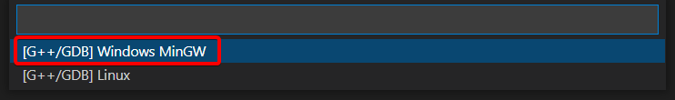


## 4.2 Présentation de l'architexture du projet C++
L'architecture du projet généré est une architecture C++ assez standard.

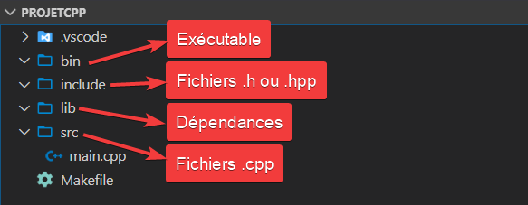

Le fichier **```Makefile```** (sous la racine) contient le paramétrage pour la construction du projet.

> **Remarque** : Le fichier Makefile suit des règles très strictes de syntaxe. Les tabulations sont à préserver ! Absolument ! [Quelques infos ici](https://sites.uclouvain.be/SystInfo/notes/Outils/make.html)

Le fichier **```main.cpp```** contient la fonction main() avec un code minimaliste d'affichage :
```cpp
/**
 * Fichier Application
 * Cible d exécution : Windows / Linux / Raspberry / ESP32 / Arduino
 * Nom du fichier :
 * Description : 
 * Dépendances (lib, classes, ...): 
 * Auteur :
 * Date :
**/

#include <iostream>				//...
#include <Windows.h>			//affichage des caractères UTF-8 dans la console

using namespace std;

int main() {
	SetConsoleOutputCP(CP_UTF8); //affichage des caractères UTF-8 dans la console
	setvbuf(stdout, nullptr, _IOFBF, 1000);

	cout << "Hello IBgenerator project!" << endl;
	
	return 0;
}
```
Le dossier **```.vscode```** contient les fichiers de paramétrage de VScode :

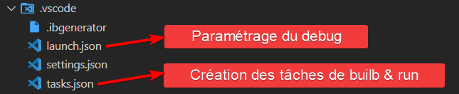

* launch.json : pour le debug
* tasks.json :  pour la création des "tâches" de build et run
* settings.json : pour les associations de fichier
* .ibgenerator : Pour que les commandes de build soient visibles dans la barre de status


# 5. Construire l'exécutable (build)
Vous pouvez lancer la construction du projet grâce à l'icône dans la barre de status.


Un terminal s'ouvre et affiche :

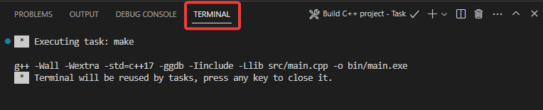

> **Remarque si la génération (build) échoue** : Vous avez peut-être plusieurs compilateurs G++ d'installés sur votre machine et la variable d'environnement PATH est mal configurée.

Le Build créé le programme exécutable dans le dossier ```bin```

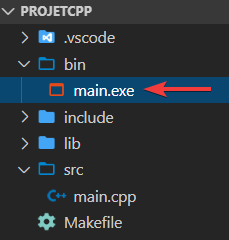

Vous pouvez exécuter le programme main.exe dans un terminal intégré à VScode.
* Clic droit sur main.exe > Open in Integrated Terminal
* Saisissez le nom de l'exécutable **```.\main.exe```** + Entrée

```ps
Microsoft Windows [version 10.0.19045.3208]
(c) Microsoft Corporation. Tous droits réservés.

I:\temp\ProjetCpp\bin>.\main.exe
Hello IBgenerator project!

I:\temp\ProjetCpp\bin> 
```

Le texte "**Hello IBgenerator project!**" est le seul affichage que produit le code source ```main.cpp```


# 6. Construire et exécuter (build and run)
Vous pouvez lancer en une seule action, la construction du projet et son exécution, grâce à l'icône dans la barre de status.


Le Build créé le programme exécutable dans le dossier ```bin``` et lance l'exécution dans un nouveau terminal intégré à VScode.

```console
./bin/main.exe
Hello IBgenerator project!

Terminal will be reused by tasks, press any key to close it.
```


# 7. Debuguer avec point d'arrêt
Modifiez le code source de ```main.cpp``` :
```cpp
#include <iostream>	 //...
#include <Windows.h> //affichage des caractères UTF-8 dans la console

using namespace std;

int main()
{
	SetConsoleOutputCP(CP_UTF8); //affichage des caractères UTF-8 dans la console
	setvbuf(stdout, nullptr, _IOFBF, 1000);

	string msg = "Bonjour à tous";
	cout << msg << endl;
	return 0;
}
```
Mettez un point d'arrêt en cliquant à gauche des numéros de ligne

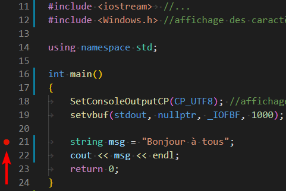

Le debug se lance en appuyant sur **```F5```** ou à partir de l'icône ```Run and debug``` de la barre d'activité > Cliquez sur la flèche verte "C++ Debug (gdb)"

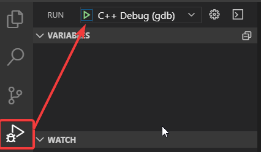

Le programme est construit puis lancé en mode debug. L'exécution s'arrête sur le point d'arrêt.

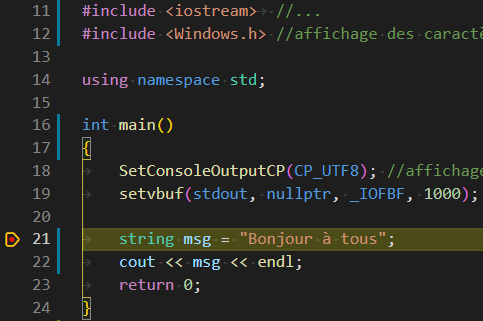

Utilisez la barre de contrôle du debug pour exécuter une ligne de code : Step Over (ou **```F10```**)


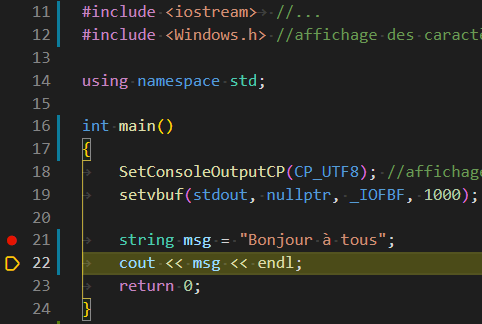

La déclaration et l'initialisation de la variable ```msg``` est exécutée.\
L'inspecteur de variable affiche le contenu de la variable ```msg```

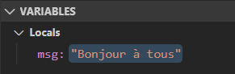

Utilisez la barre de contrôle du debug pour exécuter une autre ligne de code (**```F10```**)

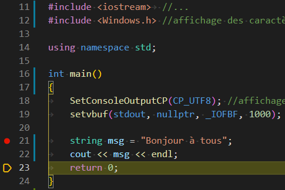

Le terminal intégré affiche le résultat de la commande ```cout```

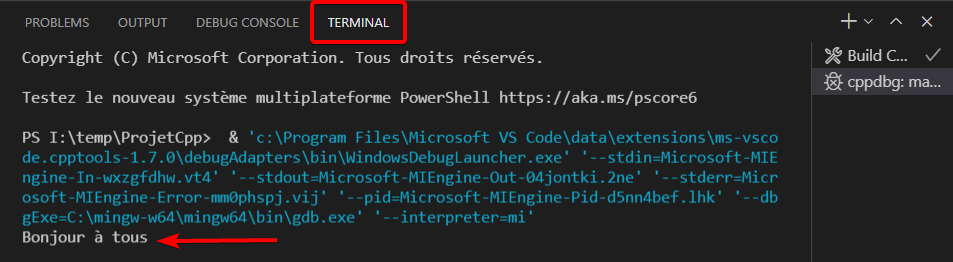

Utilisez la barre de contrôle du debug pour continuer l'exécution du programme jusqu'à la fin : Continue (ou **```F5```**)


# 8. Création d'une classe C++ avec l'assistant
## 8.1 Création de la classe
Dans la palette de commande (**```F1```**) cherchez et sélectionnez "**```IBGenerator : Create new class```**"

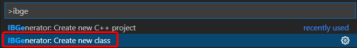

Sélectionnez la création automatique du constructeur par défaut et du destructeur

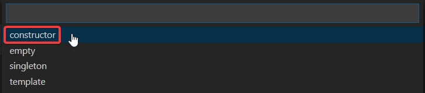

Donnez un nom à votre classe (ici, la classe Personne) puis Entrée

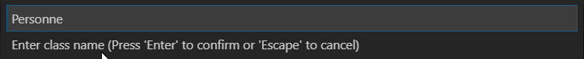

Les deux fichiers de la classe sont créés dans les bons dossiers :
* **```Personne.hpp```** (**interface** de la classe) dans le dossier ```include```
* **```Personne.cpp```** (**définition ou implémentation** de la classe) dans le dossier ```src```

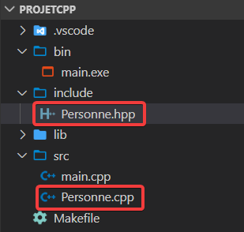

Contenu de ``` Personne.hpp``` :
```cpp
/**
 * Fichier Interface de la classe
 * Nom du fichier : 
 * Nom de la classe : 
 * Description : 
 * Auteur : 
 * Date :
**/

#pragma once

class Personne {

public:
	Personne();
	~Personne();
};
```

Contenu de ``` Personne.cpp``` :
```cpp
/**

 * Fichier Implémentation de la classe
 * Nom du fichier : 
 * Nom de la classe : 
 * Description : 
 * Auteur : 
 * Date : 
**/

#include "Personne.hpp"

// Constructeur
Personne::Personne() {

}

// Destructeur
Personne::~Personne() {

}
```

> Vous pouvez facilement passer de l'édition du fichier .hpp (interface) au fichier .cpp (implémentation) et inversement avec un clic droit dans le code source > **```Switch Header/Source```** (ou **```Alt + O```**)
> 
> 

Dans le ficher Personne.cpp, si l'intellisense de VScode ne trouve pas l'emplacement du fichier interface, il faut laisser le curseur de la souris sur l'erreur soulignée en rouge, puis cliquer sur "**```Quick fix```**"

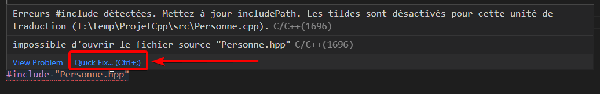

Puis ajouter le dossier include du projet à includePath

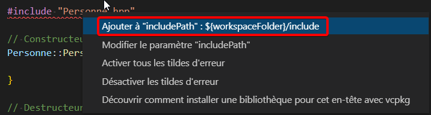

## 8.2 Ajout d'un attribut et d'une méthode à la classe
Editez le code source de l'interface ``` Personne.hpp```. Ajoutez :
* les directives d'include et de namespace
* les modificateurs d'accès (private et public)
* l'attribut ```string nom```
* la méthode ```string LireNom()```

```cpp
#pragma once
#include <iostream>
using namespace std;

class Personne {

private:
    string nom = "Gwénaël Laurent";
public:
    Personne();
    ~Personne();
    string LireNom();
};
```

Pour créer l'implémentation (= définition) de la méthode LireNom dans le fichier Personne.cpp, il suffit de faire un clic droit sur le nom de la méthode > **```Create Declaration / Definition```**

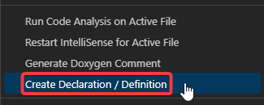

Il ne reste plus qu'à coder le contenu de cette fonction dans ``` Personne.cpp```

```cpp
string Personne::LireNom() 
{
    return nom;
}
```


## 8.3 Utilisation de la classe dans la fonction main
Dans ```main.cpp```, ajoutez :
* la directive d'include de la classe
* la création d'un objet de la classe Personne
* l'appel de la méthode LireNom()
* L'affichage du nom

```cpp
#include <iostream>	 //...
#include <Windows.h> //affichage des caractères UTF-8 dans la console
#include "Personne.hpp"

using namespace std;

int main()
{
  SetConsoleOutputCP(CP_UTF8); //affichage des caractères UTF-8 dans la console
  setvbuf(stdout, nullptr, _IOFBF, 1000);

  string msg = "Bonjour ";
  Personne objPers;
  cout << msg << objPers.LireNom() << endl;
  return 0;
}
```

Lancez en debug votre programme avec un point d'arrêt après la création de l'objet Personne.

L'inspecteur de variables permet d'inspecter le contenu des objets :

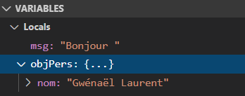

Affichage après l'exécution complète du programme :
```
Bonjour Gwénaël Laurent
```