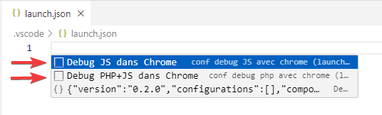

# Création de snippets pour configurer le débogage

> * Auteur : Gwénaël LAURENT
> * Date : 25/07/2023
> * OS : Windows 10 (version 22H2)
> * VScode : version 1.80.0 (system setup)

 [Licence Creative Commons](https://creativecommons.org/licenses/by-nc-sa/3.0/fr/)

- [Création de snippets pour configurer le débogage](#création-de-snippets-pour-configurer-le-débogage)
- [1. Présentation des snippets](#1-présentation-des-snippets)
- [2. Snippets pour la configuration du débogage JS et PHP](#2-snippets-pour-la-configuration-du-débogage-js-et-php)


# 1. Présentation des snippets
Les snippets (extraits de code) sont des modèles qui facilitent la saisie de code répétitifs.

Dans Visual Studio Code, les extraits de code apparaissent dans IntelliSense ( Ctrl+Espace ) mélangés à d'autres suggestions.

Les snippets peuvent être associé à un langage de programmation. Dans ce cas, ils n'apparaitront ( Ctrl+Espace ) que dans les codes de ce langage.

La création de snippets respecte des règles particulières de syntaxe. Il faut donner un nom à l'extrait de code, définir un préfixe qui correpond au texte affiché lors du ( Ctrl+Espace ) et le contenu qui sera inséré (l'extrait de code).\
De plus, on peut définir des zones dans l'extrait de code qui permettent des modifications rapides en appuyant sur la touche TAB.

Documentation officielle ["Snippets in Visual Studio Code"](https://code.visualstudio.com/docs/editor/userdefinedsnippets)

[Site utilitaire : snippet generator](https://snippet-generator.app/)

# 2. Snippets pour la configuration du débogage JS et PHP
La configuration de l'environnement de débogage dépend du langage que l'on veut déboguer (Javascript dans Chrome, PHP dans Chrome, ...).\
Cette configuration est enregistrée dans le projet, dans le fichier ```/.vscode/launch.json```. Ce fichier respecte la syntaxe "JSON with Comments" (jsonc)

Pour facilité la création de la configuration de débogage, on peut créer des snippets qui contiennent le code à insérer dans le fichier launch.json.

Par exemple, voilà comment créer un snippet qui propose deux configurations pour les fichiers launch.json :

Lors d'un ( Ctrl+Espace ) dans un fichier launch.json



Ce snippet génère le code suivant :
* Debug JS dans Chrome
    ```
    {
        "version": "0.2.0",
        "configurations": [
            {
                "type": "chrome",
                "request": "launch",
                "name": "Launch Chrome against localhost",
                "url": "http://localhost:5500/",
                "webRoot": "${workspaceFolder}"
            }
        ]
    }
    ```

* Debug PHP+JS dans Chrome
    ```
    {
        // Configuration du debug PHP+JS dans Chrome
        "version": "0.2.0",
        "configurations": [
            {
                "type": "chrome",
                "request": "launch",
                "name": "Chrome sans debug",
                "url": "http://localhost:80/alias/${relativeFile}?XDEBUG_SESSION_START=vscode",
                "webRoot": "${workspaceFolder}"
            },
            {
                "name": "xDebug seul",
                "type": "php",
                "request": "launch",
                "port": 9003
            }
        ],
        "compounds": [
        {
            "name": "Debug PHP dans Chrome",
            "configurations": ["Chrome sans debug", "xDebug seul"]
        }
        ]
    }
    ```

Pour obtenir ceci, il faut créer un fichier **```jsonc.json```** dans 
```C:\Program Files\Microsoft VS Code\data\user-data\User\snippets```

Voilà le contenu de ce snippet et [le lien pour télécharger ce jsonc.json](config/jsonc.json)

```
{
	"conf debug JS avec chrome (launch.json)": {
		"prefix": "Debug JS dans Chrome",
		"body": [
		  "{",
		  "    \"version\": \"0.2.0\",",
		  "    \"configurations\": [",
		  "        {",
		  "            \"type\": \"chrome\",",
		  "            \"request\": \"launch\",",
		  "            \"name\": \"Launch Chrome against localhost\",",
		  "            \"url\": \"http://${1:localhost}:${2:5500}/\",",
		  "            \"webRoot\": \"\\${workspaceFolder\\}\"",
		  "        }",
		  "    ]",
		  "}"
		],
		"description": "launch.json : config debug JS dans Chrome"
	  },
	  "conf debug php avec chrome (launch.json)": {
		"prefix": "Debug PHP+JS dans Chrome",
		"body": [
		  "{",
		  "    // Configuration du debug PHP+JS dans Chrome",
		  "    \"version\": \"0.2.0\",",
		  "    \"configurations\": [",
		  "        {",
		  "            \"type\": \"chrome\",",
		  "            \"request\": \"launch\",",
		  "            \"name\": \"Chrome sans debug\",",
		  "            \"url\": \"http://${1:localhost}:${2:80}/${3:alias}/${4:\\${relativeFile\\}}?XDEBUG_SESSION_START=vscode\",",
		  "            \"webRoot\": \"\\${workspaceFolder\\}\"",
		  "        },",
		  "        {",
		  "            \"name\": \"xDebug seul\",",
		  "            \"type\": \"php\",",
		  "            \"request\": \"launch\",",
		  "            \"port\": 9003",
		  "        }",
		  "    ],",
		  "    \"compounds\": [",
		  "      {",
		  "        \"name\": \"Debug PHP dans Chrome\",",
		  "        \"configurations\": [\"Chrome sans debug\", \"xDebug seul\"]",
		  "      }",
		  "    ]",
		  "}"
		],
		"description": "launch.json : config debug PHP + Chrome"
	  }
}
```

