# VScode pour coder du HTML/CSS

> * Auteur : Gwénaël LAURENT
> * Date : 25/07/2023
> * OS : Windows 10 (version 22H2)
> * VScode : version 1.80.0 (system setup)
> * Node.js : version 18.17.0

 [Licence Creative Commons](https://creativecommons.org/licenses/by-nc-sa/3.0/fr/)

- [VScode pour coder du HTML/CSS](#vscode-pour-coder-du-htmlcss)
- [1. Installation des extensions](#1-installation-des-extensions)
- [2. Créer votre projet HTML/CSS/JS](#2-créer-votre-projet-htmlcssjs)
  - [2.1 Création du dossier racine](#21-création-du-dossier-racine)
  - [2.2 Création des fichiers et dossiers](#22-création-des-fichiers-et-dossiers)
  - [2.3 Edition des fichiers](#23-edition-des-fichiers)
  - [2.4 Enregistrer les modifications](#24-enregistrer-les-modifications)
- [3. Visualisation de la page HTML dans Chrome](#3-visualisation-de-la-page-html-dans-chrome)
- [4. Sauvegarder tout le projet](#4-sauvegarder-tout-le-projet)
- [5. Pour aller plus loin ...](#5-pour-aller-plus-loin-)

# 1. Installation des extensions
Lancez VScode. Dans la barre d'activité à gauche, cliquez sur l'icône ```Extensions```.


Aidez vous de la barre de recherche pour trouver et installer les extensions suivantes :

* Auto Rename Tag (Jun Han)
* HTML to CSS autocompletion (solnurkarim)
* HTMLHint (HTMLHin)
* Live Server (Ritwick Dey)
* Material Icon Theme (Philipp Kief)
* Prettier - Code formatter (Prettier)
* Surround (Mehmet Yatkı)

Dans les résultats de recherche, cliquez sur l'extension désirée et dans la fenêtre de droite cliquez sur ```install```

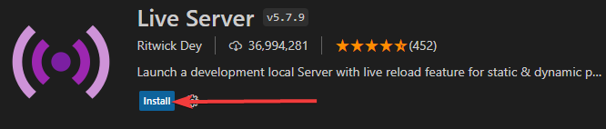

Après l'installation de toutes les extensions, fermez et ```redémarrez VScode```.

# 2. Créer votre projet HTML/CSS/JS
> Dans VScode, **un projet = un dossier**\
> Par exemple, un site web est composé de plusieurs fichiers liés entre eux. Tous ces fichiers doivent se trouver dans un dossier racine.\
> C'est ce dossier racine qu'il faut ouvrir dans VScode (et surtout pas un seul fichier, car VScode ne pourra pas faire le lien avec les autres fichiers du site web).

## 2.1 Création du dossier racine
Dans l'explorateur de fichiers de Windows, créez un dossier pour votre projet web à l'emplacement désiré, ici ```I:\temp\web\Projet1```

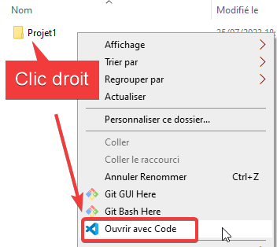

VScode va s'ouvrir. Dans la barre d'activité à gauche, cliquez sur l'icône ```Explorer``` (explorateur des fichiers de votre projet).


L'explorateur de fichiers de VScode s'ouvre sur votre dossier vide :

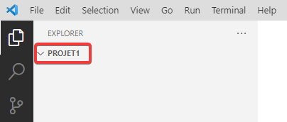


## 2.2 Création des fichiers et dossiers
1. Première technique

Passez la souris sur le nom du dossier racine, vous ferez apparaitre les icônes pour créer des fichiers ou des dossiers

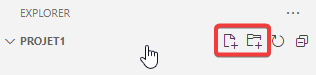

2. Deuxième technique

Clic droit dans la partie vide sous le nom du dossier racine

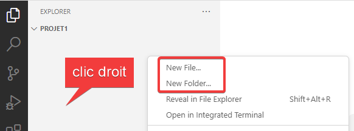

> Pour créer un fichier dans un sous dossier, il faut d'abord cliquer sur le sous dossier puis faire un clic droit dessus.

Créez l'arborescence de base suivante :

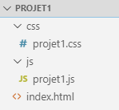

Même si ça ne se voit pas beaucoup, les fichiers CSS et JS sont tous les deux dans des sous dossiers !

> **ATTENTION à ne pas oublier les extensions des fichiers** (.html, .css, .js). VScode se base sur les extensions des fichiers pour proposer l'aide dans le bon langage de programmation !

## 2.3 Edition des fichiers
Dans l'explorateur VScode, double cliquez sur le fichier ```index.html```. Dans l'onglet ouvert, vous allez coder très rapidement la structure d'une page HTML grâce à l'assistant ```Emmet``` de VScode.

Ecrivez simplement le nom de la balise principale ```html``` (**sans les symboles < et >**) et sélectionner avec les flèches HAUT et BAS du clavier la version 5, puis Entrée.

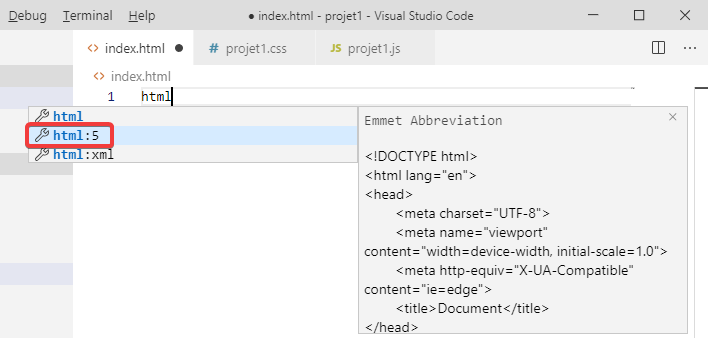

Servez vous d'Emmet pour ajouter une balise de titre ```h1``` entre ```<body>``` et ```</body>``` : on écrit h1 puis Entrée.

```html
<h1>Mon beau titre</h1>
```
Au passage, vous pouvez indiquez que votre page sera rédigée en français, en modifiant la deuxième ligne :

```html
<html lang="fr">
```

> L'assistant Emmet est appelable à tout moment avec la combinaison de touche **Ctrl  + Espace**.
> [Documentation sur les fonctions de Emmet](https://code.visualstudio.com/docs/editor/emmet)

Pour faire la **liaison avec le fichier CSS**, dans la partie ```<head></head>```, il suffit de tapper ```link``` puis de choisir ```link:css```.
Supprimez le nom du fichier par défaut (style.css) puis faites appel à Emmet pour naviguer dans l'arborescence du site jusqu'au fichier ```projet1.css```

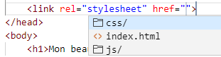

```html
<link rel="stylesheet" href="css/projet1.css">
```

Servez vous d'Emet pour faire la **liaison avec le fichier JS** juste avant la balise fermante ```</body>``` : on écrit script, on choisit script:src et on navigue jusqu'au fichier projet1.js.

```html
<script src="js/projet1.js"></script>
```
> Vous trouverez d'autres fonctionnalités de l'éditeur VScode sur le site web de VScode : [Basic Editing](https://code.visualstudio.com/docs/editor/codebasics)


## 2.4 Enregistrer les modifications
Pour enregistrer les modifications dans le code source d'un fichier il faut faire : ```File > Save``` ou **```Ctrl + S```**

Si le code a été modifié depuis son ouverture dans l'éditeur, l'onglet affiche un point rond :

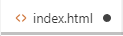

Si le code n'a pas été modifié, ou que les modifications sont enregistrées dans le fichier, l'onglet affiche une croix :

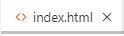


# 3. Visualisation de la page HTML dans Chrome
Dans la barre d'activité à gauche, cliquez sur l'icône ```Explorer```.


Faites un clic droit sur le fichier HTML que vous désirerz ouvrir dans Chrome, et choisissez **```Open with Live Server```**.

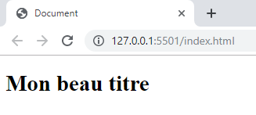

VScode lance le **```serveur web 'Live Server'```** puis lance Chrome pour qu'il affiche la page HTML sélectionnée. 

Remarquez le numéro de **port d'écoute de Live Server** dans la barre d'adresse de Chrome (ici 5501), vous en aurez besoin pour configurer le bébogage JavaScript.

Le port d'écoute de 'Live Server' est également visible dans la barre de status de VScode :
* Live Serveur arrêté : 
* Live Server démarré : 

# 4. Sauvegarder tout le projet
Dans la barre d'activité à gauche, cliquez sur l'icône ```Explorer```.


Faites un clic droit sur un fichier directement sous le dossier racine (par exemple, la page d'accueil index.html), puis sélectionnez ```Reveal in File Explorer```

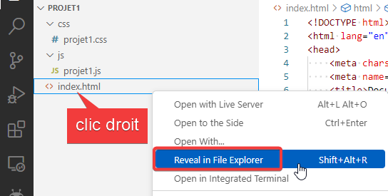

Remonter d'un dossier dans l'arborescence puis copier le dossier qui porte le nom du projet (ici c'est 'projet1').

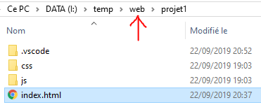

Coller ensuite tout le dossier dans votre emplacement de sauvegarde.

# 5. Pour aller plus loin ...

[Consulter la page de configuration et d'utilisation pour le développement Javascript](vscode-js.md)
