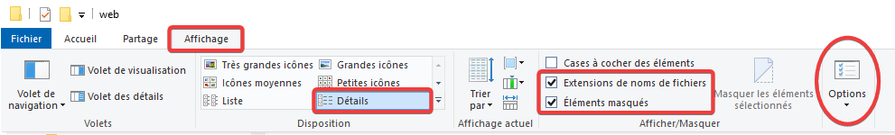
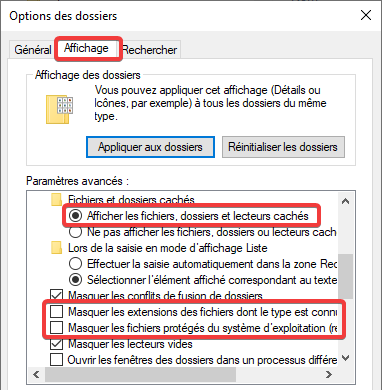
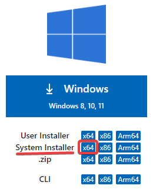
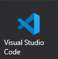

# Installation de VScode sur son ordinateur Windows

> * Auteur : Gwénaël LAURENT
> * Date : 25/07/2023
> * OS : Windows 10 (version 22H2)
> * VScode : version 1.80.0 (system setup)
> * Node.js : version 18.17.0

 [Licence Creative Commons](https://creativecommons.org/licenses/by-nc-sa/3.0/fr/)

- [Installation de VScode sur son ordinateur Windows](#installation-de-vscode-sur-son-ordinateur-windows)
- [1. Présentation](#1-présentation)
- [2. Pré-requis : configurer l'explorateur de fichier de Windows](#2-pré-requis--configurer-lexplorateur-de-fichier-de-windows)
- [3. Installation de VScode](#3-installation-de-vscode)
- [2. Installation de Node.js](#2-installation-de-nodejs)
- [2. Installation des extensions](#2-installation-des-extensions)

# 1. Présentation


[Source Wikipédia](https://fr.wikipedia.org/wiki/Visual_Studio_Code)

Visual Studio Code est un éditeur de code extensible développé par Microsoft pour Windows, Linux et macOS.

Les fonctionnalités incluent la prise en charge du débogage, la mise en évidence de la syntaxe, la complétion intelligente du code (IntelliSense), les snippets, la refactorisation du code et Git intégré. Les utilisateurs peuvent modifier le thème, les raccourcis clavier, les préférences et installer des extensions qui ajoutent des fonctionnalités supplémentaires.

Visual Studio Code est un freeware, c'est-à-dire un logiciel gratuit pour toute utilisation.

Dans le sondage auprès des développeurs réalisé par Stack Overflow en 2023, Visual Studio Code a été classé comme l'outil d'environnement de développement le plus populaire, avec 73,71 % des 86 544 répondants déclarant l'utiliser.

[Source stackoverflow](https://survey.stackoverflow.co/2023/#section-most-popular-technologies-integrated-development-environment)


# 2. Pré-requis : configurer l'explorateur de fichier de Windows
> **Attention** : l'explorateur de fichier Windows francise certains noms de dossier. Par exemple, le dossier ```Program Files``` est affiché sous le nom ```Programmes``` ou ```Program Files``` suivant les versions de Windows ... Pour connaitre le vrai nom des dosssiers dans lesquels vous naviguez, cliquez dans la barre d'adresse : 
> 
>  
> 
> 

Configurez l'explorateur Windows pour afficher les extensions des fichiers :


>
Cliquez aussi sur Options > Modifier les options des dossiers et de recherche




# 3. Installation de VScode
> L'installation des logiciels nécessite d'être administrateur de votre machine.\
> Le mode d'installation présenté ici permet de définir l'emplacement du dossier d'installation des extensions VS Code (sinon elles sont installées dans le dossier Windows AppData, et ne sont disponibles que pour un seul utilisateur de la machine).

Téléchargez la version ```System Installer``` (Windows > System Installer > x64) sur [code.visualstudio.com](https://code.visualstudio.com/Download)



Lancez l'installation en double-cliquant sur le fichier téléchargé (VSCodeSetup-x64-1.80.1.exe) : VScode sera installé dans ```C:\Program Files\Microsoft VS Code```

**AVANT de lancer VScode**, vous devez le configurer en créant les dossiers pour les extensions.

1. Dans ```C:\Program Files\Microsoft VS Code\```, créez un sous dossier ```data```
    ```
    |- C:\Program Files\Microsoft VS Code
    |   |- Code.exe
    |   |- data
    |   |- ...
    ```

2. Dans ```C:\Program Files\Microsoft VS Code\data\```, créez les 3 sous-dossiers ```user-data```, ```extensions``` et ```tmp```
    ```
    |- C:\Program Files\Microsoft VS Code
    |   |- Code.exe
    |   |- data
    |   |   |- user-data
    |   |   |   |- ...
    |   |   |- extensions
    |   |   |   |- ...
    |   |   |- tmp
    |   |- ...
    ```

Vous pouvez maitenant lancer le programme avec l'icône



[Documentation officielle pour démarrer avec VScode](https://code.visualstudio.com/docs#vscode)

# 2. Installation de Node.js
> Certaines fonctions avancées de VScode ont besoin de l'environnement d'exécution Node.js. C'est le cas, par exemple, pour la détection automatique des erreurs de codage en Javascript (ESlint).


[Doc d'installation de NodeJS](../nodejs/installer_nodejs.md)

# 2. Installation des extensions
En fonction des langages de programmation que vous utilisez vous aurez besoin d'ajouter certaines extensions à VScode. 

Les extensions utiles sont listées dans les pages correspondant aux langages de programmation : 
[Configuration et utilisation de VScode](readme.md#2-configuration-et-utilisation-de-vscode)