# VScode pour coder du JavaScript

> * Auteur : Gwénaël LAURENT
> * Date : 25/07/2023
> * OS : Windows 10 (version 22H2)
> * VScode : version 1.80.0 (system setup)
> * Node.js : version 18.17.0

 [Licence Creative Commons](https://creativecommons.org/licenses/by-nc-sa/3.0/fr/)

- [VScode pour coder du JavaScript](#vscode-pour-coder-du-javascript)
- [1. Installation des extensions](#1-installation-des-extensions)
  - [1.1 Ajout des extensions HTML/CSS](#11-ajout-des-extensions-htmlcss)
  - [1.2 Installation de l'extension ESlint](#12-installation-de-lextension-eslint)
- [2. Débogage des fichiers JavaScript](#2-débogage-des-fichiers-javascript)
  - [2.1 Création d'un projet dans VScode](#21-création-dun-projet-dans-vscode)
  - [2.2 Configuration de l'environnement de débogage](#22-configuration-de-lenvironnement-de-débogage)
  - [2.3 Lancement du débogage Javascript](#23-lancement-du-débogage-javascript)
    - [2.3.1 Ajouter un point d'arrêt](#231-ajouter-un-point-darrêt)
    - [2.3.2 Assurez vous que Live Server est lancé](#232-assurez-vous-que-live-server-est-lancé)
    - [2.3.3 Lancer le débogage Javascript dans Chrome](#233-lancer-le-débogage-javascript-dans-chrome)

> Documentation officielle ["JavaScript in Visual Studio Code"](https://code.visualstudio.com/docs/languages/javascript)

# 1. Installation des extensions
## 1.1 Ajout des extensions HTML/CSS
Si ce n'est pas déjà fait, installez toutes les extensions pour le développement HTML/CSS : [la liste est ici](vscode-html-css.md#1-installation-des-extensions)

## 1.2 Installation de l'extension ESlint
Si ce n'est pas déjà fait, installez Node.js et ESlint en suivant les explications de [Installation de NodeJS](../nodejs/installer_nodejs.md)


# 2. Débogage des fichiers JavaScript
## 2.1 Création d'un projet dans VScode
Même technique que pour les projets HTML, il faut créer un dossier sur votre disque dur et l'ouvrir dans VScode

[VScode pour code du HTML > 2. Créer votre projet HTML/CSS/JS](vscode-html-css.md#2-cr%c3%a9er-votre-projet-htmlcssjs)

Créez l'arborescence de base suivante :

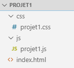

Dans le fichier **```index.html```**, dans le bloc ```<head></head>```, crééz le lien vers le fichier Javascript :

```html
<script src="js/projet1.js" defer></script>
```

Insérez le code suivant dans le fichier ```projet1.js```

```javascript
let x = 2;
x = x +5;
```

## 2.2 Configuration de l'environnement de débogage
Dans la barre d'activité à gauche, cliquez sur l'icône ```Debug``` .

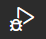

Cliquez sur "create a launch.jscon file" :

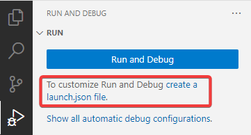

Sélectionnez l'environnement **```Web App (Chrome)```**.

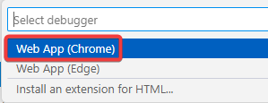

Le configuration du debug est créée dans le fichier ```/.vscode/launch.json```

```json
{
    "version": "0.2.0",
    "configurations": [
        {
            "type": "chrome",
            "request": "launch",
            "name": "Open index.html",
            "file": "i:\\temp\\web\\Projet1\\index.html"
        }
    ]
}
```

Remplacez entièrement le contenu du fichier ```launch.json``` par :

```json
{
    "version": "0.2.0",
    "configurations": [
        {
            "type": "chrome",
            "request": "launch",
            "name": "Launch Chrome against localhost",
            "url": "http://localhost:5500/",
            "webRoot": "${workspaceFolder}"
        }
    ]
}
```
> **Remarque :** sur les ordis du lycée, il suffit de supprimer le contenu du fichier > Ctrl+Espace > Choisir "Debug JS dans Chrome". Pour savoir comment créer la même chose chez vous, consultez "[Création de snippets pour configurer le débogage](./vscode-debug-snippets.md)"


Ces modifications permettent :
* de gérer le dossier racine comme une appli web complète (pas juste un fichier seul)
* d'utiliser le serveur web "Live Server" intégré à VScode en ouvrant l'URL ```http://localhost:5500/```


> **Le port d'écoute de 'Live Server'** est visible dans la barre de status de VScode quand il est démarré (ici port **```5500```**):


## 2.3 Lancement du débogage Javascript
> Les fichiers JS étant toujours chargés à partir d'une page HTML, il faut lancer le débogage JS à partir du fichier HTML qui l'appelle : index.html.

### 2.3.1 Ajouter un point d'arrêt
Ajouter un ```point d'arrêt``` sur la ligne 2 du fichier ```projet1.js``` en cliquant à gauche des numéro de lignes (vous verrez apparaitre un point rouge).

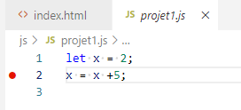


### 2.3.2 Assurez vous que Live Server est lancé
Live Server peut se commander à partir de la barre de statut de VScode (barre du bas)
* Live Serveur arrêté :  Cliquez dessus pour démarrer le serveur.
* Live Server démarré :  Cliquez dessus pour arrêter le serveur

> Quand il démarre, Live Server ouvre une fenêtre Chrome. Vous pouvez fermer cette fenêtre qui ne permet pas le débogage Javascript. Live Server restera démarré.

### 2.3.3 Lancer le débogage Javascript dans Chrome
Dans la barre d'activité de VScode > cliquez sur l'icône ```Debug``` > Cliquez sur la flèche verte devant "Launch Chrome ..."

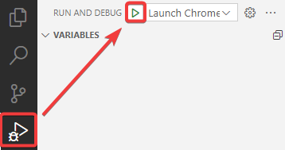

Vous pouvez aussi appuyer sur la **```touche F5```** (ça fait la même chose)

Chrome se lance et affiche la page index.html. Le fichier projet1.js est chargé dans Chrome et est exécuté immédiatement.\
**MAIS l'exécution du javascript est arrêtée sur le point d'arrêt (avant d'exécuter la ligne 2)**.

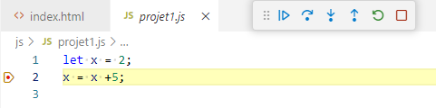

Dans VScode, on peut alors inspecter le contenu des variables :
* Dans la zone des variables en ordre alphabétique

    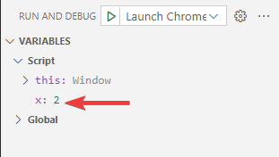

* Dans la zone des "watch" : clic droit > Add Expression > x > Entrée

    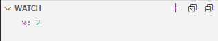

On peut aussi contrôler l'exécution du programme en pas à pas ( = une ligne de code à la fois) :

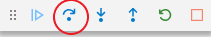

Ou continuer l'exécution jusqu'au prochain point d'arrêt :

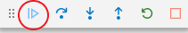

Ou arrêter le débogage :


<!-- 
# 3. Intellisense pour jQuery

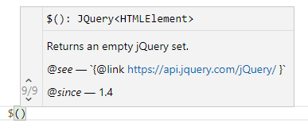

L'intellisense pour jQuery ne s'active pas automatiquement. Deux possibilités pour que ça marche :

1. Ouvrez dans l'éditeur le fichier jquery.js > l'intellisense est maintenant actif dans les autres fichiers javascript
2. Créez un fichier ```jsconfig.json``` dans le dossier racine du projet ou dans le sous-dossier contenant les fichiers JavaScript et copiez y le code suivant (ça active l'```automatic type acquisition``` de VScode):
```json
{
    "typeAcquisition": {
        "include": [
            "jquery"
        ]
    }

}
``` -->