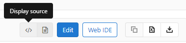
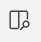
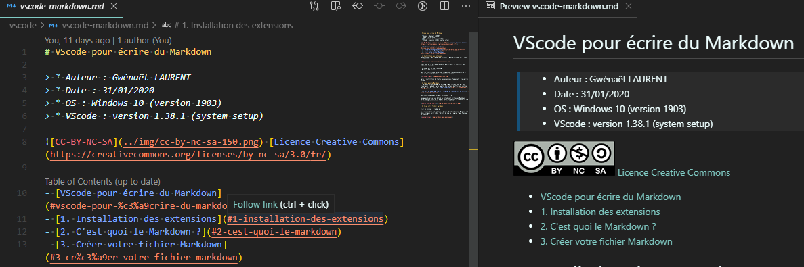

# VScode pour écrire du Markdown

> * Auteur : Gwénaël LAURENT
> * Date : 31/01/2020
> * OS : Windows 10 (version 1903)
> * VScode : version 1.38.1 (system setup)

 [Licence Creative Commons](https://creativecommons.org/licenses/by-nc-sa/3.0/fr/)

- [VScode pour écrire du Markdown](#vscode-pour-écrire-du-markdown)
- [1. Installation des extensions](#1-installation-des-extensions)
- [2. C'est quoi le Markdown ?](#2-cest-quoi-le-markdown-)
- [3. Créer votre fichier Markdown](#3-créer-votre-fichier-markdown)

# 1. Installation des extensions
Lancez VScode. Dans la barre d'activité à gauche, cliquez sur l'icône ```Extensions```.


Aidez vous de la barre de recherche pour trouver et installer les extensions suivantes :

* Markdown All in One (Yu Zhang)
* Markdown PDF (yzane)

Dans les résultats de recherche, cliquez sur l'extension désirée et dans la fenêtre de droite, ```cliquez sur install```


Après l'installation de toutes les extensions, fermez et ```redémarrez VScode```.

# 2. C'est quoi le Markdown ?
> "Markdown est un langage de balisage léger créé en 2004 par John Gruber avec l'aide d' Aaron Swartz. Son but est d'offrir une syntaxe facile à lire et à écrire." [Page wikipédia](https://fr.wikipedia.org/wiki/Markdown)

* [Un tuto de démarrage sur la syntaxe Markdown](../git/markdown_syntaxe.md)

Les fichiers Markdown ont pour extension ```.md```

Les pages hébergées sur GitLab ou GitHub sont écrites en Markdown, celle que vous lisez en ce moment aussi. Visualisez le code source via le bouton "Display source" situés en haut à droite.



# 3. Créer votre fichier Markdown

Créer un fichier ```readme.md``` 

La pévisulisation est intégrée à VScode. Quand un fichier Markdown est édité, cliquez sur l'icône à droite du nom de l'onglet "Open Preview to the side":



