# VScode pour coder du PHP

> * Auteur : Gwénaël LAURENT
> * Date : 16/05/2021
> * OS : Windows 10 (version 20H2)
> * VScode : version 1.54.3 (system setup)
> * WAMPSERVER 64 bits (x64) 3.1.9

 [Licence Creative Commons](https://creativecommons.org/licenses/by-nc-sa/3.0/fr/)

- [VScode pour coder du PHP](#vscode-pour-coder-du-php)
- [1. Installation d'un serveur web de développement](#1-installation-dun-serveur-web-de-développement)
- [2. Installation des extensions dans VScode](#2-installation-des-extensions-dans-vscode)
  - [2.2 Ajout des extensions VScode pour PHP](#22-ajout-des-extensions-vscode-pour-php)
  - [2.2 Configuration de VScode pour utiliser les extensions PHP](#22-configuration-de-vscode-pour-utiliser-les-extensions-php)
- [3. Créer votre projet PHP](#3-créer-votre-projet-php)
  - [3.1 Création du projet PHP dans VScode](#31-création-du-projet-php-dans-vscode)
  - [3.2 Hébergement sur le serveur web local (Wampserver)](#32-hébergement-sur-le-serveur-web-local-wampserver)
- [4. Configuration du débugage PHP](#4-configuration-du-débugage-php)
  - [4.1 Configuration de l'environnement de débugage](#41-configuration-de-lenvironnement-de-débugage)
  - [4.2 Lancement du débogage](#42-lancement-du-débogage)

> Documentation officielle ["PHP in Visual Studio Code"](https://code.visualstudio.com/docs/languages/php)

# 1. Installation d'un serveur web de développement

PHP s'exécute sur un serveur web ... alors vous allez en installer un sur votre ordinateur !

> Wampserver est un package logiciel. Il permet d'installer rapidement un **serveur web Apache** avec le **module PHP** actif et un serveur de **base de données MySQL** (WAMP = **W**indows **A**pache **M**ySQL **P**HP)

Suivez la procédure d'installation et de configuration dans [wampserver > wamp-installation.md](../wampserver/wamp-installation.md)


# 2. Installation des extensions dans VScode

## 2.2 Ajout des extensions VScode pour PHP
Si ce n'est pas déjà fait, installez toutes les extensions pour le développement HTML/CSS puis JS :
* [la liste est ici pour HTML/CSS](vscode-html-css.md#1-installation-des-extensions)
* [la liste est ici pour JS](vscode-js.md#1-installation-des-extensions)

Aidez vous de la barre de recherche pour trouver et installer les extensions suivantes :

* PHP Debug (Felix Becker)
* PHP Intelephense (Ben Mewburn)

Dans les résultats de recherche, cliquez sur l'extension désirée et dans la fenêtre de droite, ```cliquez sur install```

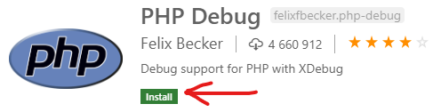

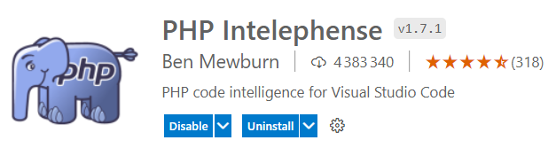

## 2.2 Configuration de VScode pour utiliser les extensions PHP
Le fichier de configuration de VScode s'appelle ```settings.json```. Vous allez le modifier pour que VScode :
* connaisse l'emplacement de l'exécutable ```php.exe```
* utilise les extensions ```PHP Intelephense```

Dans VScode : **File > Preferences > Settings**. 

Puis ouvrez les préférences au **format JSON** en cliquant sur l'icône à droite des onglets :

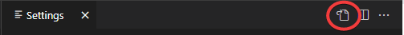

**Remplacer tout le contenu** de ```settings.json``` par celui-ci (si vous avez déjà installés les extensions pour HTML/CSS et JS):

```json
{
    "workbench.startupEditor": "newUntitledFile",
    "eslint.options": {
        "configFile": "C:/Program Files/Microsoft VS Code/.eslintrc.js"
    },
    "html.format.indentInnerHtml": true,
    "liveServer.settings.donotShowInfoMsg": true,
    "[html]": {
        "editor.defaultFormatter": "vscode.html-language-features"
    },
    "[javascript]": {
        "editor.defaultFormatter": "vscode.typescript-language-features"
    },
    "terminal.integrated.defaultProfile.windows": "Command Prompt",
    //Pour PHP
    "[php]": {
        "editor.defaultFormatter": "bmewburn.vscode-intelephense-client"
    },
    "intelephense.telemetry.enabled": false,
    "php.validate.executablePath": "C:/wamp64/bin/php/php7.3.5/php.exe",
    "php.executablePath": "C:/wamp64/bin/php/php7.3.5/php.exe",
    "php.validate.run": "onType",
    "php.suggest.basic": false
}
```

Fermez et ```redémarrez VScode```.

# 3. Créer votre projet PHP

## 3.1 Création du projet PHP dans VScode
> Même instructions que dans le §2 de [VScode pour coder du HTML/CSS](vscode-html-css.md#2-cr%c3%a9er-votre-projet-htmlcssjs)

Evidemment, les fichiers PHP ont pour extension ```.php```

1. Créer un dossier de projet sur un **``` emplacement LOCAL```** de votre ordinateur (pas sur un partage réseau et évitez les chemins comportants des espaces). Ici, j'ai choisi : ```I:\temp\web\php-test1```
2. Créez un fichier **```index.php```** avec le code suivant :

```html
<!DOCTYPE html>
<html lang="fr">
<head>
    <meta charset="UTF-8">
    <meta name="viewport" content="width=device-width, initial-scale=1.0">
    <meta http-equiv="X-UA-Compatible" content="ie=edge">
    <title>Tartes aux pommes</title>
</head>
<body>
    <h1>La tarte aux pommes</h1>
    <p>
        <?php
            $message = "C'est ma tarte préférée !";
            echo $message;
        ?>
    </p>
</body>
</html>
```

## 3.2 Hébergement sur le serveur web local (Wampserver)
Apache permet d'héberger plusieurs sites web sur le même ordinateur. Il existe 2 techniques pour cela : les alias et les virtualhosts

Suivez la procédure de création d'un alias dans [wampserver > wamp-alias-et-virtualhost.md](../wampserver/wamp-alias-et-virtualhost.md)


# 4. Configuration du débugage PHP
> Le débugage du PHP s'effectue entre Vscode (le client) et Xdebug (le serveur intégré à Apache/PHP). N'oubliez pas d'activer Xdebug dans Wampserver : Clic gauche > PHP > Configuration PHP > xdebug.remote_enable

## 4.1 Configuration de l'environnement de débugage
Il y a 2 environnement de débugage à configurer :
1. Pour le débugage PHP (```Listen for XDebug```)
2. Pour lancer Chrome (```Launch Chrome```)

Dans la barre d'activité à gauche, cliquez sur l'icône ```Debug``` .

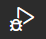

Cliquez sur la petite roue dentée :

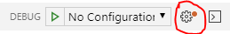

Sélectionnez l'environnement **```PHP```**. Dans le fichier de configuration ```launch.json``` gardez seulement la partie ```Listen for XDebug```:

```json
{
    // Use IntelliSense to learn about possible attributes.
    // Hover to view descriptions of existing attributes.
    // For more information, visit: https://go.microsoft.com/fwlink/?linkid=830387
    "version": "0.2.0",
    "configurations": [
        {
            "name": "Listen for XDebug",
            "type": "php",
            "request": "launch",
            "port": 9000
        }
    ]
}
```

Ajoutez maintenant la deuxième configuration en cliquant sur **```Add Configuration```**

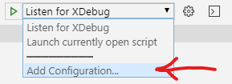

Sélectionnez **```Chrome: Launch```**

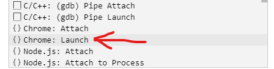

Dans le fichier de configuration ```launch.json``` modifiez la ligne de l'URL par celle de votre alias ou de votre virtualhost. Ajoutez aussi à l'URL **```${relativeFile}?XDEBUG_SESSION_START=vscode```** :
* ```{relativeFile}``` sera remplacé automatiquement par le chemin d'accès au fichier que l'on veut ouvrir dans Chrome.
* ```?XDEBUG_SESSION_START=vscode``` est une variable d'URL qu indiquera à PHP qu'il faut activer Xdebug pour cette page

```json
"url": "http://localhost/tartes/${relativeFile}?XDEBUG_SESSION_START=vscode",
```

Il reste à coupler les deux environnements d'exécution en une seule configuration composées des deux autres. C'est la partie **"compounds"** du fichier complet suivant :

> [Doc officielle sur launch.json](https://code.visualstudio.com/docs/editor/debugging#_launch-configurations) et 
> [Doc officielle sur "compounds"](https://code.visualstudio.com/docs/editor/debugging#_multitarget-debugging)
```json
{
    "version": "0.2.0",
    "configurations": [
        {
            "type": "chrome",
            "request": "launch",
            "name": "Launch Chrome",
            "url": "http://localhost/tartes/${relativeFile}?XDEBUG_SESSION_START=vscode",
            "webRoot": "${workspaceFolder}"
        },
        {
            "name": "Listen for XDebug",
            "type": "php",
            "request": "launch",
            "port": 9000
        }
    ],
    "compounds": [
      {
        "name": "Chrome + XDebug",
        "configurations": ["Launch Chrome", "Listen for XDebug"]
      }
    ]
}
```
Enregistrez le fichier ```launch.json```.


## 4.2 Lancement du débogage
Ajouter un ```point d'arrêt``` sur une ligne de code PHP en cliquant à gauche des numéro de lignes (vous verrez apparaitre un point rouge).

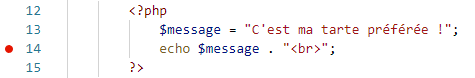

Dans la barre d'activité "Debug", sélectionnez l'environnement de débugage **```Chrome + XDebug```** dans la liste.

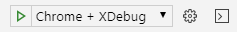

Pour lancer Chrome, il faut **```afficher le contenu du fichier index.php```** dans l'éditeur et appuyer sur la **```touche F5```**.

**Chrome est lancé et l'exécution PHP s'arrête sur le point d'arrêt** (avant d'exécuter la ligne en jaune).

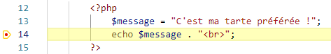

Dans VScode, on peut alors inspecter le contenu des variables :

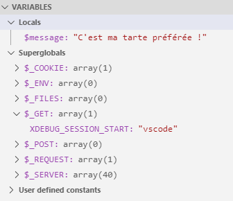

La barre de contrôle du débugage permet de choisir l'environnement de débugage à contrôler et évidemment de :
* contrôler l'exécution du programme en pas à pas (Listen for XDebug > Step Over (F10))
* continuer l'exécution jusqu'au prochain point d'arrêt  (Listen for XDebug > Continue (F5))
* arrêter le débogage (Listen for XDebug > Stop (Shift + F5))
* forcer chrome à recharger la page (Launch Chrome > Restart (Ctrl + Shift + F5))

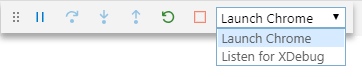

> Cette configuration est intéressante car elle permet de débuguer en même temps le code PHP **et le code Javascript** d'une page web
> 