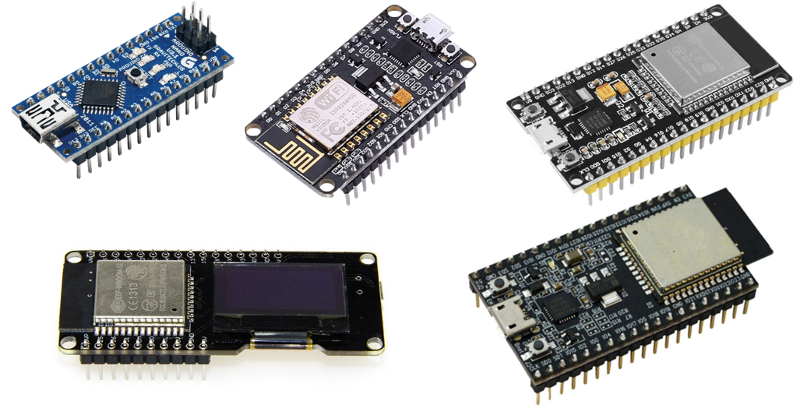
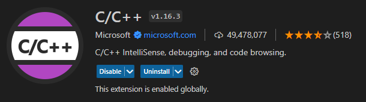
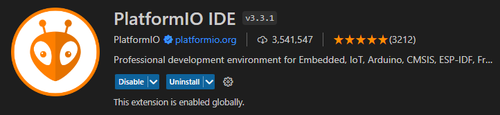
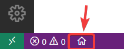
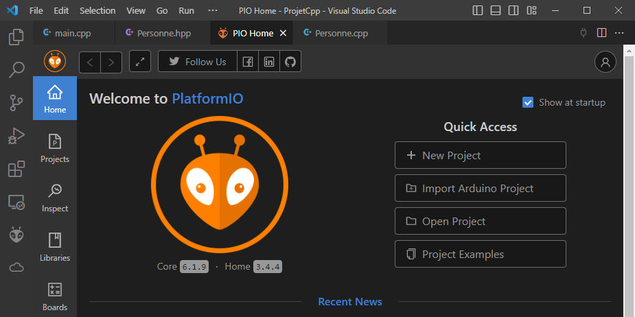
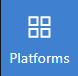
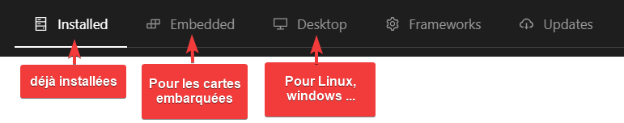

 # VScode - Installation de PlatformIO (ESP32, ESP8266, arduino)

> * Auteur : Gwénaël LAURENT
> * Date : 31/07/2023
> * OS : Windows 10 (version 22H2)
> * VScode : version 1.80.0 (system setup)
> * PlatformIO : Core 6.1.9·Home 3.4.4

 [Licence Creative Commons](https://creativecommons.org/licenses/by-nc-sa/3.0/fr/)

- [VScode - Installation de PlatformIO (ESP32, ESP8266, arduino)](#vscode---installation-de-platformio-esp32-esp8266-arduino)
- [1. Présentation de PlatformIO](#1-présentation-de-platformio)
- [2. Installation des extensions dans VScode](#2-installation-des-extensions-dans-vscode)
- [3. Démarrer PlatformIO](#3-démarrer-platformio)
- [4. Définitions des termes utilisés par PlateformIO](#4-définitions-des-termes-utilisés-par-plateformio)
- [5. Téléchargement des Platforms](#5-téléchargement-des-platforms)
- [6. Exemples d'utilisation](#6-exemples-dutilisation)

# 1. Présentation de PlatformIO
PlatformIO (PIO) est une extension de VScode qui permet de développer sur du matériel embarqué (pour l'IoT) tel que arduino et ESP.



# 2. Installation des extensions dans VScode
Lancez VScode. Dans la barre d'activité à gauche, cliquez sur l'icône ```Extensions```.


Aidez vous de la barre de recherche pour trouver et installer les extensions suivantes :

1. C/C++ (Microsoft)
2. PlatformIO





Dans les résultats de recherche, cliquez sur l'extension désirée et dans la fenêtre de droite, cliquez sur ```install```
* Attendez la fin de l'installation de PlatformIO (c'est un peu long)
* Redémarrez VScode.

# 3. Démarrer PlatformIO
A partir de la barre d'activité > PlatformIO  > PIO Home > Open

Ou à partir de la barre de statut (en bas) 

Page d'accueil de PlatformIO



# 4. Définitions des termes utilisés par PlateformIO
Bien comprendre les termes utilisés par PlatformIO :
* **Home** : pour créer un nouveau projet
* **Projects** : permet d'ouvrir ou de configurer les projets déjà créés
* **Boards** : référence de la ```carte électronique``` ou du kit de développement que vous voulez programmer 
  * Arduino Nano ATmega328
  * NodeMCU 1.0 (ESP-12E Module)
  * Espressif ESP32 Dev Module
  * [liste complète](https://docs.platformio.org/en/latest/boards/index.html)
* **Platforms** : ```type de microcontrôleur``` embarqué sur la carte électronique
  * Atmel AVR (pour les cartes arduino)
  * Espressif 8266 (pour les ESP8266)
  * Espressif 32 (Pour les ESP32)
  * [liste complète](https://docs.platformio.org/en/latest/platforms/index.html)
* **Framework** : ```Environnement de programmation``` (SDK). Certaines cartes ont plusieurs environnements possibles (C++ à la manière d'arduino, C++ temps réel pour le multi-tâche, python, ...)
  * Arduino
  * Espressif IoT Development Framework
  * FreeRTOS
  * [liste complète](https://docs.platformio.org/en/latest/frameworks/index.html)
* **Libraries** : chercher et installer des bibliothèques logicielles
* **Device** : Moyen de communiquer avec la carte électronique. Souvent, il s'agit d'un port série.
* **Monitor** : application console qui fournit un terminal série

# 5. Téléchargement des Platforms
En TP, vous allez utilisez plusieurs types de microcontrôleur.

Vous allez devoir installer les plateforms suivantes : 
* Atmel AVR (pour les cartes arduino)
* Espressif 32 (Pour les ESP32)
* Espressif 8266 (pour les ESP8266)

Dans PlateformIO, cliquez dans le menu principal (à gauche) sur l'icône "Platforms" 



Cliquez sur **Embedded** 
* chercher les platforms avec leur nom
  * Atmel AVR
  * Espressif 8266
  * Espressif 32
* Cliquez sur le nom de la platform 
* Cliquez sur Install

# 6. Exemples d'utilisation
[Cliquez pour afficher la liste des ressources](../platformio/readme.md)