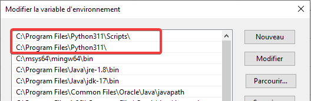
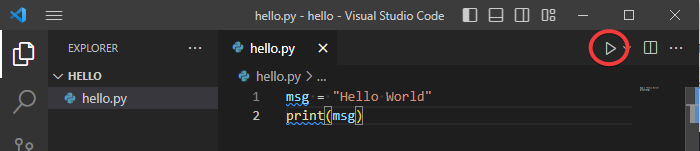
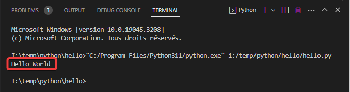
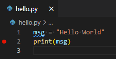
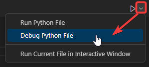
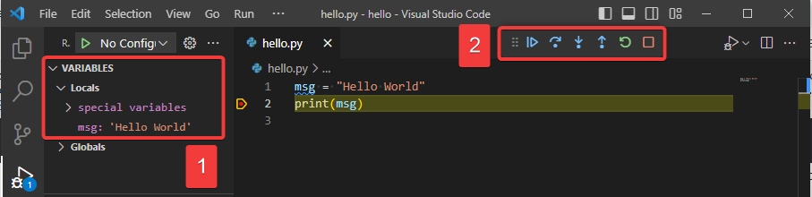
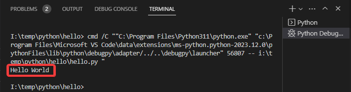

# VScode pour coder du Python

> * Auteur : Gwénaël LAURENT
> * Date : 24/07/2023
> * OS : Windows 10 (version 22H2)
> * VScode : version 1.80.0 (system setup)

- [VScode pour coder du Python](#vscode-pour-coder-du-python)
- [1. Installation de l'interpréteur Python](#1-installation-de-linterpréteur-python)
  - [1.1 Téléchargement et installation](#11-téléchargement-et-installation)
  - [1.2 Vérifier l'emplacement de python dans le PATH](#12-vérifier-lemplacement-de-python-dans-le-path)
  - [1.3 Vérification de l'installation en ligne de commandes](#13-vérification-de-linstallation-en-ligne-de-commandes)
- [2. Installation des extensions dans VScode](#2-installation-des-extensions-dans-vscode)
- [3. Création d'un projet Python](#3-création-dun-projet-python)
  - [3.1 Création d'un projet dans VScode](#31-création-dun-projet-dans-vscode)
  - [3.2 Exécuter le code](#32-exécuter-le-code)
  - [3.3 Debug avec point d'arrêt](#33-debug-avec-point-darrêt)
- [4. Activer l'interpréteur REPL dans VScode](#4-activer-linterpréteur-repl-dans-vscode)
- [5. Documentation officielle de VScode pour python](#5-documentation-officielle-de-vscode-pour-python)


# 1. Installation de l'interpréteur Python
> Pour exécuter le code Python, VScode a besoin de l'environnement d'exécution Python. Il faut donc l'installer sur votre ordinateur.


## 1.1 Téléchargement et installation
Téléchargez la dernière version : (Python 3.11.4 pour Windows) sur [www.python.org](https://www.python.org/downloads/)

Lancez l'installation en double-cliquant sur le fichier téléchargé (python-3.11.4-amd64.exe)
* Cochez ```Add Python to PATH```
* Cliquez sur ```Customize Installation```
* Cochez ```Install for all users```
* ```Disable path length limit```
   
L'interpréteur Python sera installé à l'emplacement : **```C:\Program Files\Python311\python.exe```**

> Pour info, la doc officielle d'installation sous windows : https://docs.python.org/fr/3/using/windows.html


## 1.2 Vérifier l'emplacement de python dans le PATH
> **IMPORTANT** : il se peut que vous ayez plusieurs versions de Python installées sur votre ordi. Vous pouvez le vérifier avec la commande ```py --list```. De plus, certains logiciels embarquent une copie de l'exécutable python.exe. Il faut donc s'assurer que votre nouvelle version de python soit utilisée en priorité.

Affichez la fenêtre de modification des variables d'environnement système :
  * Touche Windows > recherchez "variables" > Cliquez sur "Modifier les variables d'environnement système" > Cliquez sur le bouton "Variables d'environnement" 

Dans la zone "```Variables système```", sélectionnez la variable ```Path``` > "```Modifier```" 

Assurez vous que les emplacements de python soient en haut de la liste, sinon déplacez les en haut.




## 1.3 Vérification de l'installation en ligne de commandes
Après l'installation, vérifiez que python est bien installé : 
1. Dans un terminal, vérifiez la version de Python :
    ```cmd
    python --version
    Python 3.11.4
    ```
2. Dans un terminal, vérifiez que le gestionnaire de paquet ```pip``` est bien installé et correspond à la version de Python que vous venez d'installer (ATTENTION : le ```V``` est en majuscule).
    ```cmd
    pip -V
    pip 23.1.2 from C:\Program Files\Python311\Lib\site-packages\pip (python 3.11)
    ```


<!-- Dans une Invite de commandes > "Exécuter en tant qu'administrateur"
* Tappez la commande suivante pour **mettre à jour pip**
    ```cmd
    python -m pip install --upgrade pip
    ```
    La dernière version est bien installée :
    ```cmd
    pip -V
    pip 19.3.1 from c:\program files (x86)\python38-32\lib\site-packages\pip (python 3.8)
    ```
* Tappez la commande suivante pour **installer le linter pylint**
    ```cmd
    pip install pylint
    ```
    La commande suivante montre la version de pylint et son emplacement sur le disque :
    ```cmd
    pip show pylint
    [...]
    Version: 2.4.3
    [...]
    Location: c:\program files (x86)\python38-32\lib\site-packages
    [...]
    ``` -->

# 2. Installation des extensions dans VScode
Lancez VScode. Dans la barre d'activité à gauche, cliquez sur l'icône ```Extensions```.


Aidez vous de la barre de recherche pour trouver et installer les 3 extensions suivantes :

* Python (Microsoft) - pack comprenant : 
	* Pylance (Microsoft)
* Pylint (Microsoft)
* Mypy Type Checker (Microsoft)
* Jupyter (Microsoft) - pack comprenant : 
	* Jupyter Cell Tags (Microsoft)
	* Jupyter Keymap (Microsoft)
	* Jupyter Notebook Renderers (Microsoft)
	* Jupyter Slide Show (Microsoft)

Dans les résultats de recherche, cliquez sur l'extension désirée et dans la fenêtre de droite, cliquez sur ```install```

<!-- > Un **linter** est un analyseur syntaxique du code. Il met en évidence :
> * les erreurs de code
> * les problèmes de syntaxe
> * le non respect de style
>
> **linter vs débugueur** : le linter détecte les erreurs pendant l'édition du code (analyse statique) tandis que le débugueur détecte les erreurs pendant l'exécution (analyse dynamique) -->


# 3. Création d'un projet Python
## 3.1 Création d'un projet dans VScode
Même technique pour tous les projets VScode, il faut créer un dossier sur votre disque dur et l'ouvrir dans VScode.

> Les fichiers source Python ont pour extension **```.py```**

1. Créer un dossier de projet sur un emplacement local de votre ordinateur. Ici, j'ai choisi : ```I:\temp\python\hello\```
2. Créez un fichier **```hello.py```** avec le code suivant :
    ```python
    msg = "Hello World"
    print(msg)
    ```

## 3.2 Exécuter le code
Cliquez sur la flèche d'exécution en haut à droite :



Le programme python est exécuté dans le terminal intégré à VScode :




## 3.3 Debug avec point d'arrêt
Cliquez à gauche des numéros de ligne pour mettre un point d'arrêt sur la ligne 2 :



A côté de la flèche d'exécution, sélectionnez "Debug Python File"



Le programme est exécuté en mode débug et s'arrête avant d'exécuter la ligne 2.\
On peut visualiser l'état des variables (1) et contrôler l'exécution du reste du programme (2).



Les affichages du programme sont visibles dans le terminal intégré à VScode



# 4. Activer l'interpréteur REPL dans VScode
Pour activer l'exécution des scripts python dans un interpréteur interactif (REPL = read–eval–print loop) il faut aller dans les paramètres de VScode (Settings).

Il faut chercher :
* Python › Terminal: Launch Args (Python launch arguments to use when executing a file in the terminal)
* Cliquer sur "Edit in settings.json"
* Ajouter l'argument "-i" quand VScode lance un script python
  ```json
  "python.terminal.launchArgs": [
      "-i"
  ]
  ```

# 5. Documentation officielle de VScode pour python
> * [Python in Visual Studio Code](https://code.visualstudio.com/docs/languages/python)
> * [Getting Started with Python in VS Code (Tutorial)](https://code.visualstudio.com/docs/python/python-tutorial)
> * [Editing Python in Visual Studio Code](https://code.visualstudio.com/docs/python/editing)
> * [Linting Python in Visual Studio Code](https://code.visualstudio.com/docs/python/linting)
> * [Python debug configurations in Visual Studio Code](https://code.visualstudio.com/docs/python/debugging)
> * [Working with Jupyter Notebooks in Visual Studio Code](https://code.visualstudio.com/docs/python/jupyter-support)
> * [Working with the Python Interactive window](https://code.visualstudio.com/docs/python/jupyter-support-py)
> * [Using Python environments in VS Code](https://code.visualstudio.com/docs/python/environments)
> * [Python testing in Visual Studio Code](https://code.visualstudio.com/docs/python/testing)