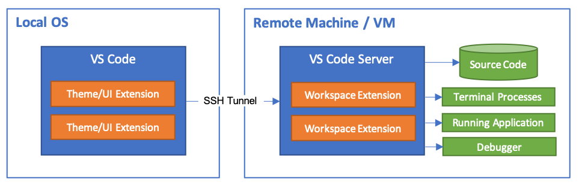
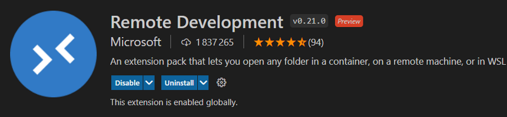
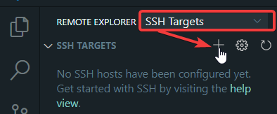
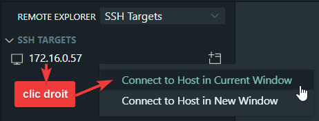
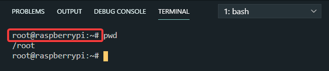
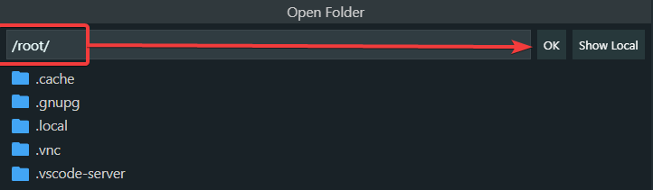
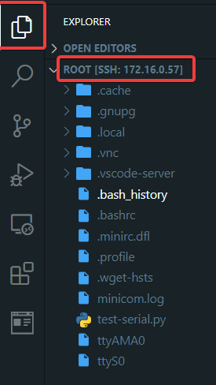
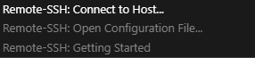
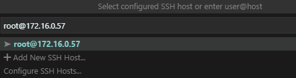

# VScode pour coder à distance (en utilisant SSH)

> * Auteur : Gwénaël LAURENT
> * Date : 02/01/2021
> * OS : Windows 10 (version 1903)
> * VScode : version 1.52.1 (system setup)
> * Node.js : version 12.16.2

 [Licence Creative Commons](https://creativecommons.org/licenses/by-nc-sa/3.0/fr/)


- [VScode pour coder à distance (en utilisant SSH)](#vscode-pour-coder-à-distance-en-utilisant-ssh)
- [1. A quoi ça sert ?](#1-a-quoi-ça-sert-)
- [2. Installation du serveur SSH sur le raspberry](#2-installation-du-serveur-ssh-sur-le-raspberry)
- [2. Installation du client SSH pour Windows](#2-installation-du-client-ssh-pour-windows)
- [3. Installation des extensions dans VScode](#3-installation-des-extensions-dans-vscode)
- [4. Enregistrer une connexion distante](#4-enregistrer-une-connexion-distante)
- [5. Terminal distant](#5-terminal-distant)
- [6. Les fichiers distants dans VScode](#6-les-fichiers-distants-dans-vscode)
- [7. Annexe : Connexion rapide à un hôte distant](#7-annexe--connexion-rapide-à-un-hôte-distant)

> Documentation officielle ["Remote Development using SSH"](https://code.visualstudio.com/docs/remote/ssh)


# 1. A quoi ça sert ?
L'objectif est d'utiliser un ordi de développement pour créer des programmes sur une autre machine, c'est du ```Remote Development```.

Exemple : utiliser un ordi Windows pour coder et déboguer des programmes **sur un Raspberry** (pour toute la suite, on considère que la machine distante est un raspberry).

VScode propose des extensions qui permettent de faire du développement à distance grâce au **```protocole SSH```** ([Wikipédia Secure Shell](https://fr.wikipedia.org/wiki/Secure_Shell)).



> Quand on utilise VScode avec l'extension Remot-SSH, VScode installe automatiquement sur l'ordi distant un "serveur VScode".

# 2. Installation du serveur SSH sur le raspberry
Sur le Raspberry, il faut installer un serveur SSH : **c'est déjà fait par défaut sur les distributions Raspbian**.

Il faut configurer le serveur SSH pour que l'utilisateur root puisse se connecter. C'est pratique quand un programme doit avoir accès à des ressources matérielles protégées.

> ATTENTION : c'est un sérieux problème de sécurité (**à désactiver en déploiement**)

Sous Raspbian, dans un terminal, il faut commencer par créer un mot de passe pour l'utilisateur ```root``` (par défaut, il n'a pas de mot de passe). Ouvrez un terminal sur le Raspberry et tappez la commande :

```sh
sudo passwd root
```
Il faut ensuite autoriser l’accès SSH pour root dans le fichier de configuration du serveur SSH :

```sh
sudo nano /etc/ssh/sshd_config 
#Modifier la ligne 
#PermitRootLogin prohibit-password
#Par 
PermitRootLogin yes
```

Dans l'éditeur de texte ```nano```, on enregistre avec Ctrl + O, et on quitte avec Ctrl + X

Il faut ensuite redémarrer la raspberry

```sh
sudo reboot
```
# 2. Installation du client SSH pour Windows
Il faut installer le client SSH de Microsoft pour Windows 10 : ```OpenSSH```. Le client OpenSSH est une fonctionnalité installable de Windows 10 à partir de la version 1809.

> ATTENTION : le client SSH ```Putty``` ne peut pas être utilisé par VScode pour le développement à distance

Si c'est déjà fait sur votre ordinateur, la commande console ```ssh``` doit afficher :
```shell
C:\Users\gwenael>ssh
usage: ssh [-46AaCfGgKkMNnqsTtVvXxYy] [-B bind_interface]
           [-b bind_address] [-c cipher_spec] [-D [bind_address:]port]
           [-E log_file] [-e escape_char] [-F configfile] [-I pkcs11]
           [-i identity_file] [-J [user@]host[:port]] [-L address]
           [-l login_name] [-m mac_spec] [-O ctl_cmd] [-o option] [-p port]
           [-Q query_option] [-R address] [-S ctl_path] [-W host:port]
           [-w local_tun[:remote_tun]] destination [command]
```

Sinon la commande ssh n'est pas trouvée. Dans ce cas, il faut installer le client SSH de Microsoft.

Dans Paramètres > Applications > Fonctionnalités facultatives > Client OpenSSH : Installer

([Doc de Microsoft pour installer OpenSSH](https://docs.microsoft.com/fr-fr/windows-server/administration/openssh/openssh_install_firstuse))

Quand le client SSH est installé, on peut l'utiliser en ligne de commande dans une invite de commande windows. 

Il faut [générer une paire de clés SSH](../gitlab/readme.md#44-génération-dune-paire-de-clés-ssh) en utilisant la commande ```ssh-keygen``` dans un terminal.

Ensuite, pour se connecter à un raspberry d'adresse IP 172.16.0.57 :
```cmd
C:\Users\gwenael>ssh root@172.16.0.57
root@172.16.0.57's password:
Linux raspberrypi 5.4.79-v7+ #1373 SMP Mon Nov 23 13:22:33 GMT 2020 armv7l
...
root@raspberrypi:~#
...
root@raspberrypi:~# exit
logout
Connection to 172.16.0.57 closed.

```

# 3. Installation des extensions dans VScode
Lancez VScode. Dans la barre d'activité à gauche, cliquez sur l'icône ```Extensions```.


Aidez vous de la barre de recherche pour trouver et installer le pack d'extensions ```Remote Development (Microsoft)``` :



Ce pack va installer automatiquement ces 5 extensions :
* Remote - SSH
* Remote - SSH: Editing Configuration Files
* Remote - Containers
* Remote - WSL
* Remote Development

Après l'installation du pack, une nouvelle icône est apparue dans la barre d'activité à gauche :

 "Remote explorer"

et un nouvel élément dans la barre de status (en bas à gauche):

 "Open Remote Window"

# 4. Enregistrer une connexion distante
Cliquez sur ```Remote explorer```  dans la barre d'activité, puis dans la zone "```SSH TARGETS```", cliquez sur le "```+```"



Les informations à fournir sont les suivantes :
* L'utilisateur et l'adresse IP de la machine distante sous la forme : **```user@hostname```**
* > A la place, on peut aussi saisir la commande ssh complète avec des options de connexion si nécessaire
* L'emplacement du fichier de config à utiliser pour enregistrer cette connexion. Le plus sécurisé est de choisir le dossier de profil de l'utilisateur : ```C:\users\gwenael\.ssh\config```

Dans la zone ```SSH TARGETS``` de ```Remote explorer``` vous verrez apparaitre la connexion sauvegardée.



Clic droit sur la connexion pour vous connecter à l'hôte distant :
* sélectionnez le système d'exploitation distant (linux)
* enregistrez l'identification de la machine distante (fingerprint ... > Continue)
* saisissez le mot de passe de l'utilisateur distant 
* après un instant, VScode est connecté à la machine distante.

> Si la connexion ne veut pas s'établir (erreur) il se peut que l'identication de la machine distante (fingerprint) est changée par rapport à celle qui est enregistrée sur votre ordinateur. Dans ce cas supprimer l'ancienne ligne correspondant à la machine distante dans le fichier ```C:\Users\gwenael\.ssh\known_hosts```

**Pour se déconnecter de l'hôte distant** :
* Cliquez sur "Open Remote Window"  dans la barre de status et sélectionnez "```Close Remote Connection```"
* ou File > Close Remote Connection
* ou fermez VScode.


# 5. Terminal distant
Quand vous êtes connectés à l'hôte distant, le terminal de VScode est celui de la machine distante (c'est un terminal SSH)



> Vous êtes directement dans le dossier personnel de l'utilisateur distant

# 6. Les fichiers distants dans VScode
Dans la barre d'activité, cliquez sur l'icône "Explorer" 

Cliquez sur **```Open Folder```** pour sélectionner le dossier distant à ouvrir dans VScode.



Il faut refournir le mot de passe de l'utilisateur distant pour afficher les fichiers :



Vous pouvez créer des fichiers ou des dossiers comme si vous étiez en local.

# 7. Annexe : Connexion rapide à un hôte distant
> C'est la façon la plus rapide de se connecter, mais ça n'enregistre pas les paramètres de connexion. Il faut donc tout ressaisir à chaque fois.
> 
Cliquez sur "Open Remote Window"  dans la barre de status et sélectionnez "```Remote-SSH: Connect to Host ...```"



Saisissez l'utilisateur et l'adresse IP de la machine distante sous la forme : ```user@hostname``` puis Entrée



Une nouvelle fenêtre VScode apparait :
* sélectionnez le système d'exploitation distant (linux)
* enregistrez l'identification de la machine distante (fingerprint ... > Continue)
* saisissez le mot de passe de l'utilisateur
* après un instant, VScode est connecté à la machine distante.


* Le terminal est celui de la machine distante
* L'icône fichier permet d'ouvrir un dossier sur la machine distante

**Pour se déconnecter de l'hôte distant** :
* Cliquez sur "Open Remote Window"  dans la barre de status et sélectionnez "```Close Remote Connection```"
* ou File > Close Remote Connection
* ou fermez VScode.
