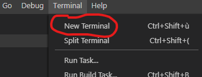
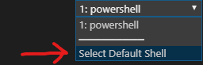
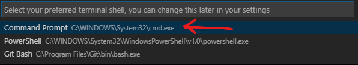

# Utiliser l'invite de commande CMD directement dans VScode

> * Auteur : Gwénaël LAURENT
> * Date : 29/09/2019
> * OS : Windows 10 (version 1903)
> * VScode : version 1.38.1 (system setup)
> * Node.js : version 10.16.3

 [Licence Creative Commons](https://creativecommons.org/licenses/by-nc-sa/3.0/fr/)


Dans VScode, ouvrez un terminal (Invite de commande Windows directement dans VScode) à partir du menu principal : Terminal > New 



En bas à droite,  modifiez le terminal par défaut :



En haut, une fenêtre s'ouvre, sélectionnez : "**Command Prompt** C:\WINDOWS\System32\\```cmd.exe```"



Fermez le terminal ouvert :


Et réouvrez un nouveau Terminal (le terminal doit être de type **cmd**)

