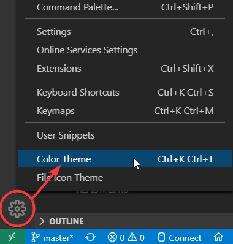
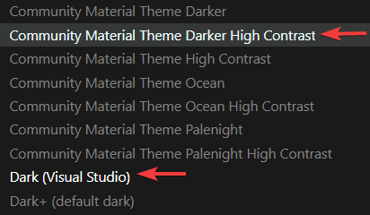
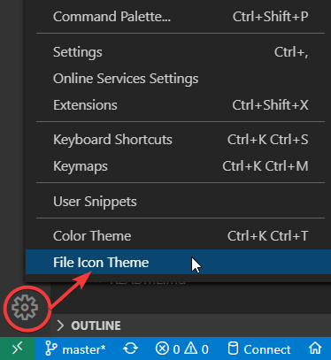
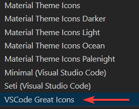
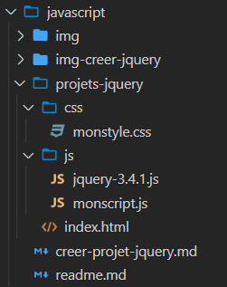

# VScode : Thèmes, couleurs et icônes

> * Auteur : Gwénaël LAURENT
> * Date : 20/04/2020
> * OS : Windows 10 (version 1903)
> * VScode : version 1.43.0 (system setup)

 [Licence Creative Commons](https://creativecommons.org/licenses/by-nc-sa/3.0/fr/)

- [VScode : Thèmes, couleurs et icônes](#vscode--th%c3%a8mes-couleurs-et-ic%c3%b4nes)
- [1. Objectifs](#1-objectifs)
- [2. Installation des extensions](#2-installation-des-extensions)
- [3. Configuration de l'apparence](#3-configuration-de-lapparence)

# 1. Objectifs
L'apparence de VScode est déjà configurable. Vous pouvez choisir entre un thème clair ou un thème foncé (F1> Preferences : Color Theme).

Grâce à des extensions, vous pouvez aller plus loin dans la personnalisation.

Je vous présente ici mes préférences.

# 2. Installation des extensions
Lancez VScode. Dans la barre d'activité à gauche, cliquez sur l'icône ```Extensions```.


Aidez vous de la barre de recherche pour trouver et installer les extensions suivantes :

* Bracket Pair Colorizer (CoenraadS)
* Community Material Theme (Mattia Astorino)
* Material Theme (Mattia Astorino)
* Material Theme Icons (Mattia Astorino)
* VSCode Great Icons (Emmanuel Béziat)

Dans les résultats de recherche, cliquez sur l'extension désirée et dans la fenêtre de droite, ```cliquez sur install```

Après l'installation de toutes les extensions, fermez et ```redémarrez VScode```.

# 3. Configuration de l'apparence
Le ***```choix du thème```*** se fait 
* A partir de la palette de commande : F1> Preferences : ```Color Theme```
* A partir de la roue dentée en bas à gauche de VScode



Personnellement, j'en aime bien 2 :



Le ***```choix des icônes```*** se fait 
* A partir de la palette de commande : F1> Preferences : ```File Icon Theme```
* A partir de la roue dentée en bas à gauche de VScode



Personnellement, j'aime bien :



Ce qui donne des petites icônes à gauche des fichiers de l'explorateur. Par exemple :

