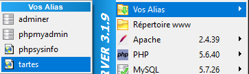
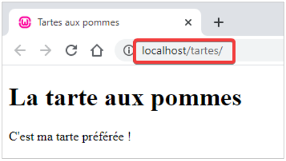
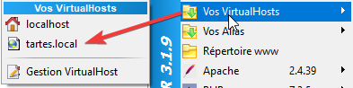
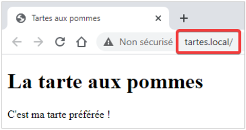
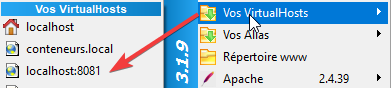
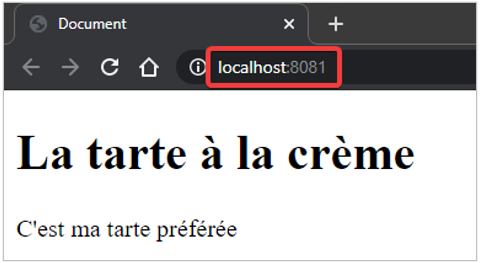

# WampServeur : Alias et VirtualHost

> * Auteur : Gwénaël LAURENT
> * Date : 07/01/2024
> * WAMPSERVER 64 bits (x64) 3.3.0
> * Apache 2.4.54.2

 [Licence Creative Commons](https://creativecommons.org/licenses/by-nc-sa/3.0/fr/)

- [WampServeur : Alias et VirtualHost](#wampserveur--alias-et-virtualhost)
- [1. Présentation](#1-présentation)
- [2. Création d'un **alias** dans Apache](#2-création-dun-alias-dans-apache)
  - [2.1 Création d'un alias](#21-création-dun-alias)
  - [2.2  Activer l'accès à distance pour un alias](#22--activer-laccès-à-distance-pour-un-alias)
- [3. Création d'un **VirtualHost par nom d'hôte** dans Apache](#3-création-dun-virtualhost-par-nom-dhôte-dans-apache)
- [4. Création d'un **VirtualHost par port** dans Apache](#4-création-dun-virtualhost-par-port-dans-apache)
  - [4.1 Création d'un VirtualHost par port](#41-création-dun-virtualhost-par-port)
  - [4.2  Activer l'accès à distance pour un VirtualHost par port](#42--activer-laccès-à-distance-pour-un-virtualhost-par-port)

# 1. Présentation
Apache permet d'héberger plusieurs sites web sur le même ordinateur. Il existe 2 techniques pour cela : les alias et les virtualhosts


**Les alias** :
* L'URL du site est de la forme http://localhost/nom-de-l-alias/
* très faciles à mettre en oeuvre
* ne modifient pas la configuration réseau de l'ordinateur
* conseillés pour la prise en main de PHP

**Les virtualhosts par nom d'hôte** :
* L'URL du site est de la forme http://nom-du-virtualhost/
* facile à mettre en oeuvre mais en administrateur seulement
* modifient la configuration réseau de l'ordinateur (fichier hosts)
* conseillés pour les frameworks back-end 

**Les virtualhosts par port** :
* L'URL du site est de la forme http://adresse-ip:8081/
* plus de configuration, en administrateur seulement
* modifient la configuration réseau de l'ordinateur (fichier hosts)
* modifient la configuration du firewall
* conseillés pour les frameworks back-end pour tester les accès à distance

> **ATTENTION** : A vous de faire votre choix : soit un alias, soit un virtualhost, **```MAIS PAS les deux en même temps vers le MÊME dossier de site web```**


# 2. Création d'un **alias** dans Apache
## 2.1 Création d'un alias
> La technique présentée ici est celle des **```Alias```** :
> - ```nom de l'alias``` : nom sous lequel sera appelé le site web local (http://localhost/nom-de-l-alias/)
> - **ATTENTION** : le nom de l'alias ne doit comporter que des minuscules, pas d'espaces, pas d'accents, pas de tiret bas
> - ```dossier du site``` : dossier dans lequel on souhaite héberger le site local
> - **ATTENTION** : le chemin d'accès au dossier du site web ne doit pas comporter d'anti-slash (``\``) mais que des **slashs** (``/``) et un **slash à la fin**

Vous allez créer un **alias ```tartes```** pour votre dossier ```I:\temp\web\php-test1```.
Votre site web sera donc accessible à l'adresse : **```http://localhost/tartes/```**

Création d'un alias sur le serveur web Apache pour héberger votre projet :
1. Clic gauche sur l'icône Wampserver > Apache > Répertoires Alias > Créer un alias :
2. Dans l'invite de commande qui s'ouvre : 
   1. Enter your alias = ```tartes``` + Entrée
   2. Enter the destination path of your alias = ```I:/temp/web/php-test1/``` (avec des **slashs** et un **slash à la fin**) + Entrée
   3. Entrée

Pour visualiser le site à partir de Wampserver : 
* Clic gauche sur l'icône Wampserver > Vos Alias > tartes






## 2.2  Activer l'accès à distance pour un alias
L'alias est créé mais il n'est accessible qu'en local (à partir de la même machine). Pour le rendre accessible à partir d'une autre machine il faut modifier l'alias et configurer le firewall de Windows.

1. Modification de l'alias pour autoriser les accès à distance : Clic gauche sur l'icône Wampserver > Apache > Répertoires Alias > URL de votre alias > Modifier l'alias (cela va ouvrir le contenu du fichier de configuration d'Apache pour l'alias : C:\wamp64\alias\nom_alias.conf)
   1. A l'intérieur des balises <Directory> et </Directory> se touve un ensemble de directives qui ne s'appliquent qu'au répertoire précisé
       ```conf
         Alias /tartes "I:/temp/web/php-test1/"
         <Directory "I:/temp/web/php-test1/">
            Options +Indexes +FollowSymLinks +MultiViews
         AllowOverride all
            Require local
         </Directory>
       ```
   2. Modifiez ```Require local``` par ```Require all granted```
       ```conf
         Alias /tartes "I:/temp/web/php-test1/"
         <Directory "I:/temp/web/php-test1/">
            Options +Indexes +FollowSymLinks +MultiViews
         AllowOverride all
            Require all granted
         </Directory>
       ```

       Documentation officielle sur la directive ```Require``` : [ici](https://httpd.apache.org/docs/2.4/fr/howto/access.html) et [ici](https://httpd.apache.org/docs/2.4/fr/mod/mod_authz_host.html#requiredirectives)

   3. Si besoin, redémarrez Apache (ou wampserver) pour forcer Apache à relire ses fichiers de configuration

Autoriser les connexions entrantes dans le firewall de Windows (Defender).

2. Ouvrez le pare-feu windows : Appuyez sur la touches "Windows" puis rechercher "pare-feu windows Defender".

    Dans "Pare-feu Windows Defender" > Cliquez sur "Paramètres avancés" > "Règles de trafic entrant" > "Nouvelle règle..."
    * Type de règle : Port
    * Protocol et ports : 
      * TCP
      * Ports locaux spécifiques : 80 (port d'écoute par défaut du serveur Apache)
    * Action : Autoriser la connexion
    * Profil : Privé (décochez les autres)
    * Nom : apache 80


# 3. Création d'un **VirtualHost par nom d'hôte** dans Apache

> La technique présentée ici est celle des **```VirtualHosts par nom d'hôte```** :
> - ```nom du Virtual Host``` : nom sous lequel sera appelé le site web local (http://nom-du-virtualhost/)
> - **ATTENTION** : le nom du virtualhost ne doit comporter que des minuscules, pas d'espaces, pas d'accents, pas de tiret bas
> - **ATTENTION** : le nom du virtualhost ne doit pas correspondre à un nom de domaine existant sur internet. Pour cela, on suffixe toujours le nom du virtualhost par **.local**
>  - **Fichier Hosts** : les noms des virtualhosts sont enregistrés dans le fichiers ```C:/WINDOWS/system32/drivers/etc/hosts```. C'est le premier consulté pour la résolution DNS.
> - ```dossier du site``` : dossier dans lequel on souhaite héberger le site local
> - **ATTENTION** : le chemin d'accès au dossier du site web ne doit pas comporter d'anti-slash (``\``) mais que des **slashs** (``/``) et un **slash à la fin**

Si vous créez un **virtualhost ```tartes.local```** pour votre dossier ```I:\temp\web\php-test1```.
Votre site web sera donc accessible à l'adresse : **```http://tartes.local/```**

Création d'un virtualhost sur le serveur web Apache pour héberger votre projet :
1. Clic gauche sur l'icône Wampserver > Vos VirtualHosts > Gestion VirtualHost :
2. Sur la page web qui s'ouvre : 
   1. Nom du Virtual Host = ```tartes.local```
   2. Chemin complet absolu du dossier VirtualHost = ```I:/temp/web/php-test1/``` (avec des **slashs** et un **slash à la fin**)
   3. Cliquez sur "Démarrer la création du VirtualHost"
   4. Fermez la nouvelle page web qui s'affiche ("Les fichiers ont été modifiés ...")
3.  Clic droit sur l'icône Wampserver > Outils > Redémarrage DNS

Pour visualiser le site à partir de Wampserver : 
* Clic gauche sur l'icône Wampserver > Vos VirtualHosts > tartes.local






# 4. Création d'un **VirtualHost par port** dans Apache
## 4.1 Création d'un VirtualHost par port
> La technique présentée ici est celle des **```VirtualHosts par port```** :
> - ```nom du Virtual Host``` : seulement utile pendant la création du virtualhost
> - ```Listen port``` : un nombre supérieur à 8080 : c'est le port d'écoute d'Apache pour ce virtualhost. Le numéro de port se retrouve dans l'adresse du site web (http://localhost:8081/ ou http://adresse_IP:8081/)
> - ```dossier du site``` : dossier dans lequel on souhaite héberger le site local
> - **ATTENTION** : le chemin d'accès au dossier du site web ne doit pas comporter d'anti-slash (``\``) mais que des **slashs** (``/``) et un **slash à la fin**

Création d'un virtualhost par port sur le serveur web Apache pour héberger votre projet :
1. Ajoutez un port d'écoute à Apache
   1. Clic droit sur l'icône Wampserver > Outils > Ajouter un Listen port à Apache : choisir un port disponible supérieur à 8080 (dans la suite de mon exemple j'ai choisi 8081, mais prenez le premier port disponible après 8080)
2. Créez le VirtualHost en y associant le port d'écoute
   1. Clic gauche sur l'icône Wampserver > Vos VirtualHosts > Gestion VirtualHost :
   2. Nom du Virtual Host = ```localhost```
   3. Chemin complet absolu du dossier VirtualHost = ```I:/temp/web/php-test2/``` (avec des **slashs** et un **slash à la fin**)
   4. Cocher et choisir le nouveau port d'écoute créé précédemment ```Listen Port : 8081```
   5. Cliquez sur "Démarrer la création du VirtualHost"
   6. Fermez la nouvelle page web qui s'affiche ("Les fichiers ont été modifiés ...")
3.  Clic droit sur l'icône Wampserver > Outils > Redémarrage DNS

Pour visualiser le site à partir de Wampserver : Clic gauche sur l'icône Wampserver > Vos VirtualHosts > tartes.local





## 4.2  Activer l'accès à distance pour un VirtualHost par port
Le VirtualHost est créé mais il n'est accessible qu'en local (à partir de la même machine). Pour le rendre accessible à partir d'une autre machine il faut modifier le VirtualHost et configurer le firewall de Windows.

1. Modification du VirtualHost pour autoriser les accès à distance : Clic gauche sur l'icône Wampserver > Apache > httpd-vhosts.conf
   1. Chercher la ```directive <VirtualHost></VirtualHost>``` correspondant au nouveau port découte
       ```conf
       <VirtualHost *:${MYPORT8081}>
       ServerName localhost
       DocumentRoot "I:/temp/web/php-test2/"
       <Directory  "I:/temp/web/php-test2/">
         Options +Indexes +Includes +FollowSymLinks +MultiViews
         AllowOverride All
         Require local
       </Directory>
       </VirtualHost>
       ```
   2. Modifiez ```Require local``` par ```Require all granted```
       ```conf
       <VirtualHost *:${MYPORT8081}>
       ServerName localhost
       DocumentRoot "I:/temp/web/php-test2/"
       <Directory  "I:/temp/web/php-test2/">
         Options +Indexes +Includes +FollowSymLinks +MultiViews
         AllowOverride All
         Require all granted
       </Directory>
       </VirtualHost>
       ```

       Documentation officielle sur la directive ```Require``` : [ici](https://httpd.apache.org/docs/2.4/fr/howto/access.html) et [ici](https://httpd.apache.org/docs/2.4/fr/mod/mod_authz_host.html#requiredirectives)

   3. Si besoin, redémarrez Apache (ou wampserver) pour forcer Apache à relire ses fichiers de configuration

Autoriser les connexions entrantes dans le firewall de Windows (Defender).

1. Ouvrez le pare-feu windows : Appuyez sur la touches "Windows" puis rechercher "pare-feu windows Defender".

    Dans "Pare-feu Windows Defender" > Cliquez sur "Paramètres avancés" > "Règles de trafic entrant" > "Nouvelle règle..."
    * Type de règle : Port
    * Protocol et ports : 
      * TCP
      * Ports locaux spécifiques : 8081 (à adapter avec votre nouveau port)
    * Action : Autoriser la connexion
    * Profil : Privé (décochez les autres)
    * Nom : apache 8081
