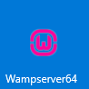
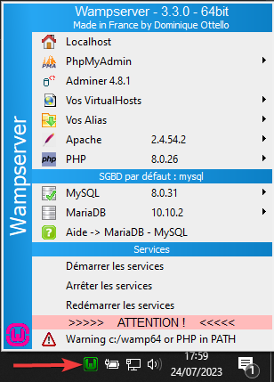
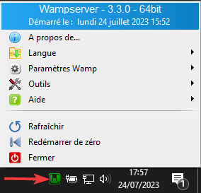

# Installation de WampServer

> * Auteur : Gwénaël LAURENT
> * Date : 24/07/2023
> * WAMPSERVER 64 bits (x64) 3.3.0

 [Licence Creative Commons](https://creativecommons.org/licenses/by-nc-sa/3.0/fr/)

- [Installation de WampServer](#installation-de-wampserver)
- [1. Présentation](#1-présentation)
- [2. Télécharger et installer les "Visual C++ Redistribuable Packages"](#2-télécharger-et-installer-les-visual-c-redistribuable-packages)
- [3. Télécharger et installer Wampserver (v3.3.0)](#3-télécharger-et-installer-wampserver-v330)
- [4. Lancer Wampserver64](#4-lancer-wampserver64)
- [5. Paramétrer Wampserver](#5-paramétrer-wampserver)

# 1. Présentation

PHP s'exécute sur un serveur web ... alors vous allez en installer un sur votre ordinateur !

> Wampserver est un package logiciel. Il permet d'installer rapidement un **serveur web Apache** avec le **module PHP** actif et un serveur de **base de données MySQL** (WAMP = **W**indows **A**pache **M**ySQL **P**HP)


# 2. Télécharger et installer les "Visual C++ Redistribuable Packages"
Wampserver nécessite d'installer les bibliothèques Microsoft pour C++. Vous en avez peut-être déja installées sur votre ordinateur.

Pour connaitre les versions "Visual C++ Redistribuable Packages" qu'il vous manque, téléchargez et exécutez le logiciel **check_vcredist.exe** à cette adresse : https://wampserver.aviatechno.net/ > Outils > Vérifications paquetages VC++ installés :
* version française
* Utilisez vous une version 5.x de PHP ? : NON
* Vérifier


Téléchargez les "Visual C++ Redistribuable Packages" à cette adresse : https://wampserver.aviatechno.net/ > "Visual C++ Redistribuable Packages"> Microsoft VC packages VC2008, 2010, 2012, 2013, 2015-2022 zip files >  All VC Redistribuable Packages (x86_x64) (32 & 64bits)
* Enregistrez le fichier **all_vc_redist_x86_x64.zip** sur votre ordi
* dézipper et installer les packages nécessaires (en double-cliquant sur les fichiers) dans l'ordre chronologique des versions et en commençant toujours par la version x86, puis x64.

# 3. Télécharger et installer Wampserver (v3.3.0)
[Page de téléchargement sur wampserver.com](http://www.wampserver.com/)
   * Dans la rubrique Télécharger
   * Cliquez sur la dernière version 64 bits (x64)
   * Cliquez sur "Passer au téléchargement direct" ou enregistrez vous...
   * Enregistrez le fichier wampserver3.3.0_x64.exe sur votre ordi


Double-cliquez sur le fichier téléchargé (wampserver3.3.0_x64.exe)
* installation dans c:\wamp64
* navigateur web : Choisissez un autre navigateur : **```Chrome```** (C:\Program Files\Google\Chrome\Application\chrome.exe)
* Editeur de texte : Garder Notepad.exe comme éditeur de texte de Wampserver.


# 4. Lancer Wampserver64
   


Wampserver s'administre à partir de l'icône à droite de la barre des tâches : **```Clic gauche```** ou **```Clic droit```** sur l'icône verte.




> Si l'icône n'est pas verte, il faut redémarrer les services (clic gauche > Redémarrer les services) ou redémarrer Wampserver (clic droit > Fermer)

# 5. Paramétrer Wampserver
Il faut vous assurer que toutes les extensions suivantes sont bien activées (coche verte) et/ou bien paramétrées :
* Activer la **```réécriture d'URL```** d'Apache :
  * Clic gauche > Apache > Modules Apache > rewrite_module
* Choisir la version de PHP **```8.0.26```** :
  * Clic gauche > PHP > Version > 7.3.5
* Activer les **```extensions PHP```** :  Clic gauche > PHP > Extensions PHP
  * intl
  * mbstring
  * mysqli
  * pdo_mysql
* Activer le débugage PHP à distance avec **```Xdebug```** :
  * Clic gauche > PHP > Extensions PHP > xdebug 3.1.6
  * Clic gauche > PHP > Configuration PHP > xdebug.mode = debug
  * Clic gauche > PHP > Configuration PHP > xdebug.log_level = 10 (Debug Breakpoint)
* Choisir une version de **```MySQL >= 5```** :
  *  Clic gauche > MySQL > Version > 8.0.31
* Afficher le menu des **```alias```** :
  * Clic droit > Paramètres Wamp > Sous-menu Alias

