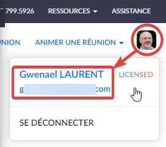
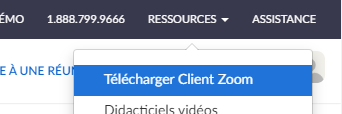
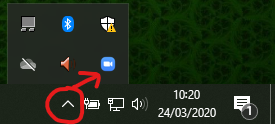
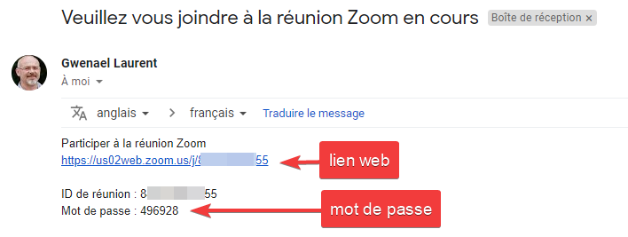
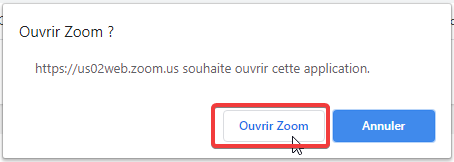
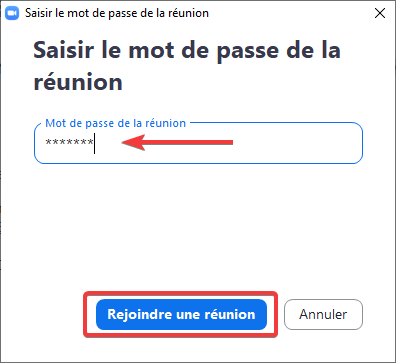
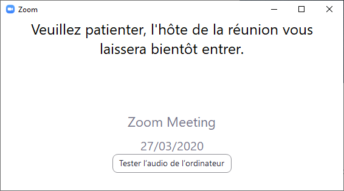
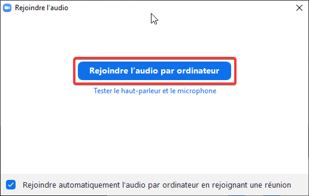
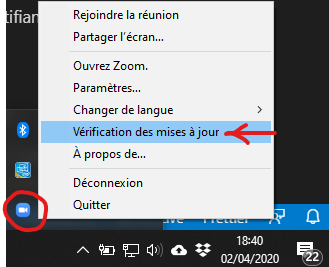
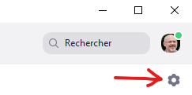

# Installation de Zoom pour les visioconférences

> * Auteur : Gwénaël LAURENT
> * Date : 11/05/2020
> * OS : Windows 10 (version 1903)
> * Zoom 5.0.1

 [Licence Creative Commons](https://creativecommons.org/licenses/by-nc-sa/3.0/fr/)

- [Installation de Zoom pour les visioconférences](#installation-de-zoom-pour-les-visioconf%c3%a9rences)
  - [1. Zoom, qu’est-ce que c’est ?](#1-zoom-quest-ce-que-cest)
  - [2. Créer un compte chez Zoom](#2-cr%c3%a9er-un-compte-chez-zoom)
  - [3. Installer le logiciel Zoom](#3-installer-le-logiciel-zoom)
  - [4. Accepter une invitation à une visioconférence](#4-accepter-une-invitation-%c3%a0-une-visioconf%c3%a9rence)
  - [5. Si vous n'avez ni webcam, ni micro](#5-si-vous-navez-ni-webcam-ni-micro)
  - [6. Mettre à jour l'application Zoom](#6-mettre-%c3%a0-jour-lapplication-zoom)
  - [7. Paramétrer son compte zoom](#7-param%c3%a9trer-son-compte-zoom)
    - [7.1 Personnel > Paramètres](#71-personnel--param%c3%a8tres)
    - [7.2 Administrateur > Gestion de compte > Paramètres du compte](#72-administrateur--gestion-de-compte--param%c3%a8tres-du-compte)

## 1. Zoom, qu’est-ce que c’est ?


Zoom est une application de visioconférence.

Zoom recouvre les principaux cas d'usage de la web conférence, du chat et de la réunion en ligne. 

Zoom permet de créer une salle virtuelle dans laquelle les collaborateurs peuvent interagir aussi bien depuis leur ordinateur que depuis leur tablette ou leur smartphone.

## 2. Créer un compte chez Zoom
Rendez vous à l'adresse [https://zoom.us/](https://zoom.us/)
* Saisissez votre adresse e-mail (**celle que vous avez donné à vos profs d"informatique**)
* Cliquez sur ```Inscrivez-vous gratuitement```


* Cliquez sur ```Confirmer``` (confirmer votre adresse e-mail)
* Cliquez sur ```Confirmer``` (confirmer la transmission de certaines ressources)

Consultez vos e-mails. Dans le mail reçu de Zoom (objet : "Veuillez réactiver votre compte Zoom"), cliquez sur ```Activation du compte```
Vous êtes alors rediririgés vers la page web "Bienvenue à Zoom". Saisissez alors vos :
* Prénom
* Nom
* Mot de passe (conformez vous à la complexité du mot de passe !)

Cliquez sur ```Continuer```

Quand vous arrivez sur la page web "N'utilisez pas Zoom seul" : **C'est bon, votre compte est créé et fonctionnel**.

> **```Remarque importante```** : Il n'est pas nécessaire de donner plus d'information que votre e-mail et votre nom. Par contre, **saisissez vos vrais nom et prénom**, parce que c'est comme ça que vous serez affichés dans Zoom, et que si je ne vous connais pas, je ne vous accepterai pas aux visio !
> 
> Vous pouvez accéder à votre profil utilisateur pour modifier ces informations en cliquant en haut à droite de la fenêtre :
> 
> 

## 3. Installer le logiciel Zoom
Il vous faut maintenant télécharger le logiciel zoom :

Cliquez en haut à droite de la fenêtre sur "Ressources" > Télécharger client Zoom



* Cliquez sur le bouton ```Télécharger``` (Client Zoom pour les réunions)
* Quand le fichier est téléchargé (ZoomInstaller.exe, environ 10Mo) > cliquez dessus pour lancer l'installation du logiciel

Dans la première fenêtre du logiciel, cliquez sur ```Connexion``` :
* Saisissez **votre e-mail et le mot de passe que vous avez choisis lors de la création de votre compte Zoom**
* Cochez la case "Ne pas déconnecter"
* Cliquez sur ```Connexion```

**C'est fini !**

La configuration par défaut de Zoom fait que le logiciel est toujours actif, même quand vous fermez la fenêtre. Vous pouvez réouvrir / paramètrer Zoom à partir des icônes de la barre des tâches de Windows (Clic droit sur l'icône de Zoom)



> Si vous voulez paramétrer votre logiciel, cliquez en haut à droite du logiciel, sur la petite roue dentée


## 4. Accepter une invitation à une visioconférence

> **Cette étape ne concerne que l'utilisation de Zoom en dehors de la plateforme collaborative "Slack"**

L'animateur de la visio vous enverra ```un mail``` contenant une lien web et un mot de passe.



```Cliquez sur le lien web```, votre navigateur va s'ouvrir sur le site web de Zoom et une fenêtre d'alerte apparait.



Cliquez sur ```Ouvrir Zoom```. Votre logiciel Zoom s'ouvre sur une demande de mot de passe :



``Saisissez le mot de passe`` reçu dans le mail d'invitation, puis cliquez sur ````Rejoindre une réunion````.

Une fenêtre vous permet de vérifier le réglage de votre caméra (c'est le moment de vérifier votre apparence et votre arrière plan ...).


Cliquez sur ```Rejoindre avec une vidéo```.

Vous arrivez maintenant dans la ```salle d'attente``` de la visioconférence.



Quand l'animateur vous acceptera dans la visioconférence, vous serez ```en ligne``` avec tous les participants : *Pensez à dire bonjour !*


Quand vous passez la souris dans la fenêtre de zoom, les commandes apparaissent en bas de la fenêtre. 


```Vérifiez que votre caméra et votre micro sont bien actifs.``` Par exemple, dans l'image ci-dessus, la barre du bas indique que le micro et la caméra sont désactivés.

```Cliquez sur l'icône de la caméra``` pour que tous les participants puissent vous voir.

```Cliquez sur l'icône du micro``` pour que tout le monde puisse vous entendre. 


La première fois que vous activez l'audio, vous devrez sans doute cliquer sur ```Rejoindre l'audio par l'ordinateur```.



Si vous voulez modifier la configuration audio / vidéo de zoom, cliquez sur les flèches à côté des icônes du micro et la caméra :


Pour quitter la visioconférence, il suffit de cliquer sur ```Fin``` à droite de la barre de commandes, puis ```Quitter la réunion```


## 5. Si vous n'avez ni webcam, ni micro
L'appli Zoom existe en version mobile sur les stores d'android ou d'apple. Vous pouvez l'installer sur votre tablette ou votre smartphone. C'est une solution très pratique pour la visioconférence.

Cependant, ce n'est pas toujours suffisant pour le partage d'écran pendant les cours d'informatique, encore moins si vous devez me montrer votre code source qui se situe sur votre ordinateur !

La solution consiste alors à installer Zoom sur votre ordinateur et de **```vous servir de votre smartphone comme une webcam```**. Il n'y a pas consommation de données 4G, tout se passe en wifi sur votre réseau local.


Installez sur votre smartphone iVCam Webcam (de e2eSoft) à partir de votre store.

Installez le logiciel client Windows à partir de [http://www.e2esoft.com/ivcam](http://www.e2esoft.com/ivcam/)


## 6. Mettre à jour l'application Zoom
Pour des raisons de sécurité, mettez à jour assez fréquemment votre application Zoom. 

Quand zoom est lancé, clic droit sur son icône dans la barre des tâches (en bas à droite de l'écran Windows) puis sélectionnez Vérification des mises à jour. Ensuite il faut choisir de télécharger / installer la dernière mise à jour.




## 7. Paramétrer son compte zoom

> **Cette étape concerne particulièrement les animateurs de visioconférences, les profs par exemple**

Lancer le logiciel Zoom, cliquez sur la roue dentée en haut à droite (paramètres).



Cliquez sur "Général" > Cliquez en bas de la fenêtre sur "Afficher plus de paramètres"

Une page web s'affiche, saisissez vos identifiants Zoom.

### 7.1 Personnel > Paramètres
**Dans Réunion > Programmer la réunion :**
* Accès à la réunion avant l’arrivée de l’animateur : NON
* ```Utiliser l'ID de réunion personelle (PMI) pour planifier une réunion : NON```
* ```Utiliser l'ID de réunion personelle (PMI) pour démarrer une réunion instantanée : NON```
* ```Seuls les utilisateurs authentifiés peuvent participer aux réunions : OUI```
* ```Only authenticated users can join meetings from Web client : OUI```
* ```Demander un mot de passe lors de la planification de nouvelles réunions : OUI```
* ```Demander un mot de passe pour les réunions instantanées : OUI```
* ```Demander un mot de passe pour l'ID de réunion personnelle (PMI) : OUI```
* ```Intégrez le mot de passe dans le lien de la réunion : NON```
* ```Exiger un mot de passe pour les participants qui se joignent par téléphone : OUI```

**Dans Réunion > En réunion (base) :**
* ```Converser : NON```
* ```Discussion privée : NON```
* ```Conversations enregistrées automatiquement : NON```
* ```Transfert de fichier : NON```
* Commentaires de Zoom : NON
* ```Permettre à l’animateur de mettre les participants en attente : OUI```
* Toujours afficher la barre d’outils du contrôle des réunions : OUI
* Partage d’écran : OUI
  * ```Qui peut partager ? : Hôte seulement``` (ça peut se réactiver dans l'appli si besoin ponctuel : Partager écran > Options partage avancé)
  * Qui peut commencer à partager... : Hôte seulement
* ```Annotation : NON```
* ```Tableau blanc : NON```
* ```Commande à distance : NON```
* Autoriser les participants retirés à rejoindre : NON

**Dans Réunion > En réunion (avancé) :**
* Arrière-plan virtuel : OUI
* Identifie les participants invités à la réunion / au webinaire : OUI
* Groupe de réponse automatique dans la conversation : NON
* ```Select data center regions for meetings/webinars hosted by your account : OUI```
  * Europe seulement
* ```Salle d’attente : OUI```
  * Tous les participants
* Afficher un lien « Rejoindre depuis votre navigateur » : NON
* Permet la rediffusion en direct des réunions : NON

**Dans Réunion > Notification de courriels :**
* Lorsque les participants rejoignent la réunion avant l’animateur : OUI
* Lorsqu’une réunion est annulée : OUI

**Dans Enregistrement :**
* ```Enregistrement local : NON```
* ```Enregistrement dans le Cloud : NON```
* Enregistrement automatique : NON

**Dans Téléphone :**
* Afficher les liens des numéros internationaux de l’email d’invitation : NON
* Audio de tierce partie : NON
* Masquer le numéro de téléphone dans la liste des participants : OUI

### 7.2 Administrateur > Gestion de compte > Paramètres du compte
**Dans Réunion > Programmer la réunion :**
* Les utilisateurs Office 365 peuvent autoriser les applications professionnelles à accéder aux données de l’entreprise : NON

**Dans Réunion > En réunion (base) :**
* Converser : NON
* Discussion privée : NON
* Conversations enregistrées automatiquement : NON
* Transfert de fichier : OUI
* Commentaires de Zoom : NON
* ```Permettre à l’animateur de mettre les participants en attente : OUI```


**Dans Réunion > En réunion (avancé) :**
* Arrière-plan virtuel : OUI
* Identifie les participants invités à la réunion / au webinaire : OUI
* ```Salle d’attente : OUI```
  * Tous les participants
* Afficher un lien « Rejoindre depuis votre navigateur » : NON
* Permet la rediffusion en direct des réunions : NON

**Dans Réunion > Notification de courriels :**
* Lorsque les participants rejoignent la réunion avant l’animateur : OUI
* Lorsqu’une réunion est annulée : OUI

**Dans Enregistrement :**
* ```Enregistrement local : NON```
* ```Enregistrement dans le Cloud : NON```
* Enregistrement automatique : NON

**Dans Téléphone :**
* Appel payant : NON


